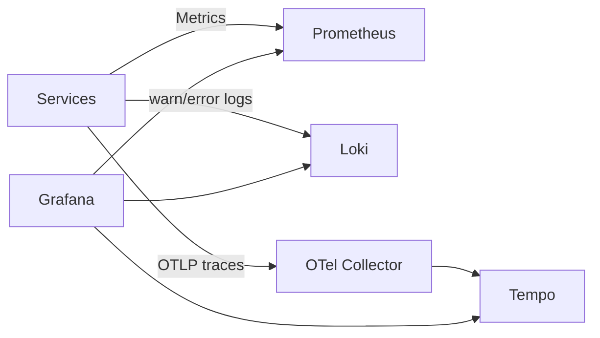

# @monadiam/local-infrastructure

Platform | Local Infrastructure: PostgreSQL/Redis, Kafka/Debezium messaging, Vault
secrets, ClickHouse/SeaweedFS audit archival, Go tooling and observability with
Prometheus, Grafana, Loki and Tempo.

### Requirements

- **Make** — runs the prepared project commands from `Makefile`, such as `make up`.
- **Docker with Compose v2** — runs the infrastructure in containers. Docker must be
  running, and Compose must support the `include` directive.
- **Go 1.27+** — required on the host for linting, tests, configuration validation
  and AWS credential import. The container CLI is built as part of the Docker images.

### Quick Start

For the first run, execute from the repository root:

```bash
make env
```

Review the settings in `.env`, then build the images and start the infrastructure:

```bash
make build
make up
docker compose ps -a
```

> - `make env` replaces an existing `.env`. You do not need to run it on every startup.
> - Wait for services to become ready and initialization containers to complete
>   successfully before starting applications from the service repositories.

----

<details>
<summary><strong>Commands</strong></summary>

| Makefile               | CLI                          | Purpose                                                  |
| :--------------------- | :--------------------------- | :------------------------------------------------------- |
| **Infrastructure**     |                              |                                                          |
| `make env`             | —                            | Copy the example to `.env`, replacing any existing file. |
| `make aws`             | `infra aws import`           | Import AWS credentials from CSV into `.env`.             |
| `make build`           | —                            | Build Compose images, including the CLI.                 |
| `make up`              | —                            | Create and start containers.                             |
| `make down`            | —                            | Remove containers and networks; preserve volumes.        |
| `make restart`         | —                            | Run `down`, then `up`.                                   |
| `make stop`            | —                            | Stop containers without removing them.                   |
| `make start`           | —                            | Start existing stopped containers.                       |
| **Development**        |                              |                                                          |
| `make lint`            | —                            | Run golangci-lint and gofmt checks.                      |
| `make lint-fix`        | —                            | Apply gofmt formatting.                                  |
| `make env-check`       | `infra config validate`      | Validate settings and templates without network calls.   |
| **Initialization**     |                              |                                                          |
| `make kafka-init`      | `infra kafka reconcile`      | Create topics and verify partition counts.               |
| `make debezium-init`   | `infra debezium reconcile`   | Create or update connectors.                             |
| `make vault-init`      | `infra vault initialize`     | Initialize or unseal Vault.                              |
| `make vault-bootstrap` | `infra vault bootstrap`      | Configure secrets, keys, policies and AppRoles.          |
| `make clickhouse-init` | `infra clickhouse reconcile` | Apply SQL schema and access grants.                      |
| `make seaweedfs-init`  | `infra seaweedfs reconcile`  | Configure buckets and retention rules.                   |
| **Archive**            |                              |                                                          |
| `make archive-run`     | `infra archive run`          | Run one archive cycle.                                   |
| **Tests**              |                              |                                                          |
| `make utest`           | —                            | Run Ginkgo tests with the race detector, without Docker. |
| `make itest`           | —                            | Run integration tests in isolated containers.            |
| **Container Startup**  |                              |                                                          |
| —                      | `infra kafka start`          | Prepare storage and start Kafka.                         |
| —                      | `infra seaweedfs start`      | Prepare credentials and start SeaweedFS.                 |
| —                      | `infra archive loop`         | Run archive cycles periodically.                         |

**CLI Options**

| Option          | Purpose                                            |
| :-------------- | :------------------------------------------------- |
| `--env-file`    | Dotenv path; an empty value disables file loading. |
| `--timeout`     | Operation timeout, e.g. `2m`.                      |
| `--connect-url` | Kafka Connect address for Debezium commands.       |
| `--template`    | Debezium connector template path.                  |
| `--csv`         | CSV path for `aws import`.                         |
| `--help`        | General or command-specific help.                  |

> - Makefile is the main entry point. To run the CLI directly, use
>   `go run . <component> <action> [options]`; for help, use `go run . --help`.
> - `ENV_FILE` selects the file for `make aws` and `make env-check`; `AWS_FILE`
>   selects the CSV to import. Example: `make env-check ENV_FILE=.env.example`.
> - Rebuild container images with `make build` after changing Go code.
> - Single-quote dotenv values containing `$`.
> - Integration tests remove their containers and volumes on completion.
> - Pass server arguments for `infra seaweedfs start` after `--`.

</details>

----

<details>
<summary><strong>Structure</strong></summary>

```text
local/
├── Makefile                             # Infrastructure, development and test commands
├── .env.example                         # Example environment settings
├── docker-compose.yml                   # Component Compose includes
├── Dockerfile                           # CLI, Kafka and SeaweedFS images
├── main.go                              # CLI entry point and shutdown handling
├── go.mod                               # Go module and dependencies
├── go.sum                               # Dependency checksums
│
├── cli/                                 # Go application and component tests
│   ├── cli.go                           # Command-line arguments
│   ├── commands.go                      # Command handlers and application state
│   ├── types.go                         # Handler type and help text
│   ├── config/                          # Configuration loading and typed settings
│   ├── platform/
│   │   ├── aws/                         # AWS credential import from CSV
│   │   ├── clickhouse/                  # SQL queries, schema and access grants
│   │   ├── debezium/                    # Connector configuration and registration
│   │   ├── http/                        # Resty defaults and HTTP error handling
│   │   ├── kafka/                       # Broker startup and topic configuration
│   │   ├── schema/                      # Schema Registry rule validation
│   │   ├── seaweedfs/                   # Credentials, buckets and retention rules
│   │   └── vault/                       # Initialization, unseal and secret configuration
│   ├── jobs/archive/                    # Partition export to Parquet
│   └── tests/integration/               # Tests against real components
│       ├── compose_helpers.go           # Test environment management
│       ├── bootstrap_helpers.go         # Vault and storage checks
│       ├── debezium_helpers.go          # Connect client and outbox setup
│       ├── bootstrap_test.go            # Bootstrap, permissions and archive scenarios
│       ├── debezium_test.go             # Connectors and event delivery
│       └── testdata/                    # Test Compose files and SQL fixtures
│
├── services/                            # Per-service PostgreSQL and Redis
│   ├── template/compose.yml
│   ├── access-control/compose.yml
│   ├── identity/compose.yml
│   ├── notification/compose.yml
│   ├── organization/compose.yml
│   └── hr/compose.yml
├── messaging/
│   ├── compose.yml                      # Kafka, UI, Registry, Connect and initialization
│   ├── kafka/server.properties          # Broker configuration
│   └── debezium/outbox.connector.json   # Outbox connector template
├── vault/
│   ├── compose.yml                      # Vault server and initialization
│   ├── config/vault.hcl                 # Server configuration
│   └── policies/                        # Service access policies
├── audit-archive/
│   ├── compose.yml                      # ClickHouse, SeaweedFS and archiver
│   ├── clickhouse/schema/               # Audit SQL schema and access grants
│   └── seaweedfs/                       # Bucket policies and lifecycle
└── observability/
    ├── compose.yml                      # Monitoring, logs, traces and exporters
    ├── prometheus/prometheus.yml        # Metrics sources
    └── grafana/provisioning/            # Datasources and dashboards
```

</details>

----

<details>
<summary><strong>Ports and Access</strong></summary>

Default ports are defined in `.env.example`. Applications run from separate service
repositories; `APP_PORT` is listed here to match each application to its databases.

**Service Host Ports**

| Service          | APP_PORT | PostgreSQL | Redis  |
| :--------------- | :------- | :--------- | :----- |
| `template`       | `4000`   | `6000`     | `7000` |
| `access-control` | `4001`   | `6001`     | `7001` |
| `identity`       | `4002`   | `6002`     | `7002` |
| `notification`   | `4003`   | `6003`     | `7003` |
| `organization`   | `4004`   | `6004`     | `7004` |
| `hr`             | `4005`   | `6005`     | `7005` |

Within Docker networks, PostgreSQL uses port `5432` and Redis uses `6379`.
Kafka is available to containers at `kafka:29092`; the broker port is not published
on the host.

**Shared Components**

| Component          | Host port | Container port | Variable                   |
| :----------------- | :-------- | :------------- | :------------------------- |
| Kafka UI           | `8080`    | `8080`         | `KAFKA_UI_PORT`            |
| Kafka Connect      | `8083`    | `8083`         | `KAFKA_CONNECT_PORT`       |
| Schema Registry    | `8081`    | `8080`         | `SCHEMA_REGISTRY_PORT`     |
| Vault              | `8200`    | `8200`         | `VAULT_PUBLISHED_PORT`     |
| ClickHouse Native  | `9000`    | `9000`         | `CLICKHOUSE_NATIVE_PORT`   |
| ClickHouse HTTP    | `8123`    | `8123`         | `CLICKHOUSE_HTTP_PORT`     |
| SeaweedFS S3       | `9010`    | `8333`         | `SEAWEEDFS_API_PORT`       |
| SeaweedFS Admin UI | `9011`    | `23646`        | `SEAWEEDFS_ADMIN_PORT`     |
| Prometheus         | `9090`    | `9090`         | `PROMETHEUS_PORT`          |
| Grafana            | `3000`    | `3000`         | `GRAFANA_PORT`             |
| Loki               | `3100`    | `3100`         | `LOKI_PORT`                |
| Tempo              | `3200`    | `3200`         | `TEMPO_PORT`               |
| OTel gRPC          | `4317`    | `4317`         | `OTEL_COLLECTOR_GRPC_PORT` |
| OTel HTTP          | `4318`    | `4318`         | `OTEL_COLLECTOR_HTTP_PORT` |

</details>

----

<details>
<summary><strong>Service Infrastructure</strong></summary>

Each service has separate `<service>-postgresql` and `<service>-redis` containers.
Their Compose files are located at `services/<service>/compose.yml`.

| Service          | PostgreSQL variable prefix  | Redis variable prefix    |
| :--------------- | :-------------------------- | :----------------------- |
| `template`       | `TEMPLATE_POSTGRES_*`       | `TEMPLATE_REDIS_*`       |
| `access-control` | `ACCESS_CONTROL_POSTGRES_*` | `ACCESS_CONTROL_REDIS_*` |
| `identity`       | `IDENTITY_POSTGRES_*`       | `IDENTITY_REDIS_*`       |
| `notification`   | `NOTIFICATION_POSTGRES_*`   | `NOTIFICATION_REDIS_*`   |
| `organization`   | `ORGANIZATION_POSTGRES_*`   | `ORGANIZATION_REDIS_*`   |
| `hr`             | `HR_POSTGRES_*`             | `HR_REDIS_*`             |

PostgreSQL logical replication is enabled for Debezium: `wal_level=logical`,
`max_replication_slots=10`, `max_wal_senders=10`.

</details>

----

<details>
<summary><strong>Vault</strong></summary>

Compose starts Vault and the containers that initialize and configure it.
The unseal key and root token are saved in the `vault_init` volume; server data is
stored in `vault_data`. The CLI also creates the local token specified by `VAULT_TOKEN`.

Each service gets an AppRole named `<service>-service` and a KV path at
`kv/<service>-service/runtime`. Access policies are stored in `vault/policies/`.

| Runtime secret field  | Purpose                                                 |
| :-------------------- | :------------------------------------------------------ |
| `postgresql_username` | PostgreSQL user for the application and migrations.     |
| `postgresql_password` | PostgreSQL password for the application and migrations. |
| `redis_password`      | Redis password for the application and seeders.         |

AWS credentials can be added to `kv/notification-service/runtime`, while
`kv/identity-service/oauth` stores OAuth provider secrets. Transit keys are used
for audit and identity token operations.

Service containers receive secrets through their own Vault Agent, using a Unix socket
and files rendered from templates.

</details>

----

<details>
<summary><strong>Kafka and Debezium</strong></summary>

`messaging/compose.yml` starts Kafka, Kafka UI, Apicurio Schema Registry,
Kafka Connect and the Debezium connector registration container.

- `make kafka-init` creates missing topics and verifies partition counts.
  The topic catalog and retention periods are defined in `cli/platform/kafka/definitions.go`.
- `make debezium-init` creates or updates outbox connectors without resetting offsets.
  Each service uses the connector name `<service>-service-outbox-connector`
  and the PostgreSQL address `<service>-postgresql:5432`.
- Delayed delivery retries use `message-dispatch-retry-notification-service`.
  Other consumers use a limited number of retries within the handler.
  Dead-letter topics are provided for final failures.

Schema Registry uses KafkaSQL. Its internal topics are created explicitly;
automatic topic creation is disabled. Readiness checks use the internal management
port `9000`.

| Variable                               | Default    | Purpose                      |
| :------------------------------------- | :--------- | :--------------------------- |
| `SCHEMA_REGISTRY_GLOBAL_VALIDITY`      | `FULL`     | Schema structure validation. |
| `SCHEMA_REGISTRY_GLOBAL_COMPATIBILITY` | `BACKWARD` | Backward compatibility.      |
| `SCHEMA_REGISTRY_GLOBAL_INTEGRITY`     | `FULL`     | Schema reference integrity.  |

> Topic initialization does not delete old messages. Process any remaining events
> before retiring previous retry topics and queues.

</details>

----

<details>
<summary><strong>Audit Storage</strong></summary>

ClickHouse stores `audit.audit_log` and `audit.change_log`; the SQL schema sets a
180-day TTL. The archiver exports monthly partitions to SeaweedFS as Parquet,
verifies row counts and records completed exports. Subsequent cycles skip
partitions already recorded as complete.

By default, the partition selection cutoff is calculated from `ARCHIVE_AFTER_DAYS=150`,
and the interval between cycles is set by `ARCHIVE_INTERVAL_SECONDS=86400` (one day).

| Default bucket       | Retention | Retention variable                    |
| :------------------- | :-------- | :------------------------------------ |
| `audit-archive`      | 1095 days | `SEAWEEDFS_AUDIT_LOG_RETENTION_DAYS`  |
| `change-log-archive` | 365 days  | `SEAWEEDFS_CHANGE_LOG_RETENTION_DAYS` |

Bucket names are set through `SEAWEEDFS_AUDIT_LOG_BUCKET` and
`SEAWEEDFS_CHANGE_LOG_BUCKET`. Versioning, Object Lock in COMPLIANCE mode and lifecycle
rules are enabled. The archiver account can read and write objects, but cannot delete
them. Policy templates are stored in `audit-archive/seaweedfs/`.

> - `make archive-run` runs one cycle; the archiver container runs cycles periodically.
> - Do not run a manual cycle concurrently with the running archiver.

</details>

----

<details>
<summary><strong>Observability</strong></summary>

Prometheus collects application and infrastructure metrics, Loki receives logs,
and OTel Collector forwards traces to Tempo. Grafana combines these sources.
Observability ports are bound to `127.0.0.1`.



Service Compose projects must join the `DOCKER_NETWORK_MONITORING=monitoring-net`
network. Application settings:

```dotenv
OTEL_EXPORTER_OTLP_ENDPOINT="http://otel-collector:4317"
OTEL_LOGS_EXPORTER="none"
LOKI_ENABLED="true"
LOKI_URL="http://loki:3100"
LOKI_BATCH_INTERVAL="5"
```

Grafana is available at `http://localhost:3000`. Provisioned dashboards include
`Services`, `PostgreSQL`, `Redis`, `Kafka`, `Queues`, `ClickHouse` and `SeaweedFS`,
with `Services` as the home dashboard. Credentials are set through
`GRAFANA_ADMIN_USER` and `GRAFANA_ADMIN_PASSWORD`.

> - Existing service `.env` files are not updated automatically. Add observability
>   settings manually or copy them from `.env.local.example`.
> - `local` does not collect Kubernetes metrics or add a service mesh around monitoring.
>   Audit data in ClickHouse/SeaweedFS is separate from operational logs in Loki.

</details>
