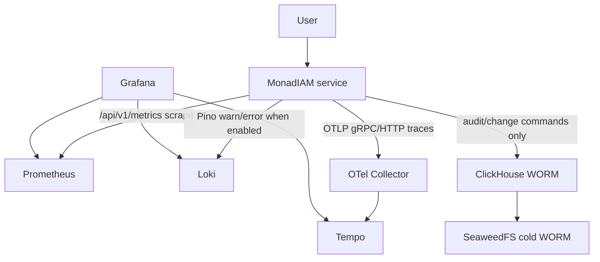

# @monadiam/local-infrastructure

Platform | Local Infrastructure: PostgreSQL/Redis, Kafka/Debezium messaging, Vault
secrets, ClickHouse/SeaweedFS audit archival, Go tooling and observability with
Prometheus, Grafana, Loki and Tempo.

### Requirements

- ***Make*** — runs the prepared project commands, such as `make up`, using the
  instructions in `Makefile`.
- ***Docker with Compose v2*** — runs the infrastructure services in containers. Docker
  must be running, and Compose must support `include`.
- ***Go 1.27+*** — builds and runs the infrastructure tooling on your computer. Needed for
  development commands, tests and `make aws`; Docker builds the container version
  automatically.

----

<details>
<summary><strong>Service Port Map</strong></summary>

| Index | Service          | HTTP APP_PORT | PostgreSQL host port | Redis host port |
| :---- | :--------------- | :------------ | :------------------- | :-------------- |
| `0`   | `template`       | `4000`        | `6000`               | `7000`          |
| `1`   | `access-control` | `4001`        | `6001`               | `7001`          |
| `2`   | `identity`       | `4002`        | `6002`               | `7002`          |
| `3`   | `notification`   | `4003`        | `6003`               | `7003`          |
| `4`   | `organization`   | `4004`        | `6004`               | `7004`          |
| `5`   | `hr`             | `4005`        | `6005`               | `7005`          |

Service containers use internal PostgreSQL port `5432` and Redis port `6379`. Only the
host-published ports above are service-indexed.

</details>

----

<details>
<summary><strong>Shared Ports</strong></summary>

| Component          | Host port | Container port | Variable                   |
| :----------------- | :-------- | :------------- | :------------------------- |
| Kafka UI           | `8080`    | `8080`         | `KAFKA_UI_PORT`            |
| Kafka Connect      | `8083`    | `8083`         | `KAFKA_CONNECT_PORT`       |
| Schema Registry    | `8081`    | `8080`         | `SCHEMA_REGISTRY_PORT`     |
| Vault              | `8200`    | `8200`         | `VAULT_PUBLISHED_PORT`     |
| ClickHouse         | `9000`    | `9000`         | `CLICKHOUSE_NATIVE_PORT`   |
| ClickHouse         | `8123`    | `8123`         | `CLICKHOUSE_HTTP_PORT`     |
| SeaweedFS API      | `9010`    | `8333`         | `SEAWEEDFS_API_PORT`       |
| SeaweedFS Admin UI | `9011`    | `23646`        | `SEAWEEDFS_ADMIN_PORT`     |
| Prometheus         | `9090`    | `9090`         | `PROMETHEUS_PORT`          |
| Grafana            | `3000`    | `3000`         | `GRAFANA_PORT`             |
| Loki               | `3100`    | `3100`         | `LOKI_PORT`                |
| Tempo              | `3200`    | `3200`         | `TEMPO_PORT`               |
| OTel Collector     | `4317`    | `4317`         | `OTEL_COLLECTOR_GRPC_PORT` |
| OTel Collector     | `4318`    | `4318`         | `OTEL_COLLECTOR_HTTP_PORT` |

</details>

----

<details>
<summary><strong>Structure</strong></summary>

```text
local/
├── Makefile                            # Infrastructure and development commands
├── docker-compose.yml                  # Root Compose include manifest
├── Dockerfile                          # CLI image and Kafka/SeaweedFS runtime targets
├── main.go                             # Go CLI entry point
├── go.mod                              # Go module and dependencies
├── go.sum                              # Dependency checksums
│
├── cli/                                # Go application and tests
│   ├── cli.go                          # Argument parsing and command dispatch
│   ├── commands.go                     # Command handlers
│   ├── types.go                        # CLI option and handler types
│   ├── cli_test.go                     # Command-line scenarios
│   ├── config/                         # Environment loading and connector settings
│   ├── platform/
│   │   ├── aws/                        # AWS CSV import into dotenv
│   │   ├── clickhouse/                 # SQL schema, users and grants
│   │   ├── debezium/                   # Connector configuration and registration
│   │   ├── http/                       # Shared HTTP client
│   │   ├── kafka/                      # Startup, topics and partition checks
│   │   │   └── definitions.go          # Topic catalog and retention defaults
│   │   ├── schema/                     # Schema Registry rule validation
│   │   ├── seaweedfs/                  # Credentials, buckets, retention and lifecycle
│   │   └── vault/                      # Initialization, unseal and bootstrap
│   │       └── definitions.go          # Mounts, keys, roles and secret field mappings
│   ├── jobs/
│   │   └── archive/                    # Parquet archive cycle and periodic job
│   │       └── definitions.go          # Archive tables and export projections
│   └── tests/
│       └── integration/                # Disposable bootstrap, outbox and archive tests
│           ├── types.go                # Shared fixture and result types
│           ├── compose_helpers.go      # Compose and CLI execution
│           ├── bootstrap_helpers.go    # Storage and Vault fixtures
│           ├── debezium_helpers.go     # Connector readiness and outbox fixtures
│           ├── integration_test.go     # Ginkgo suite entry point
│           ├── bootstrap_test.go       # Bootstrap, permissions and archive scenarios
│           ├── debezium_test.go        # Connector, outbox and Kafka scenarios
│           └── testdata/               # Compose stacks and SQL fixtures
│
├── services/                           # Per-service PostgreSQL and Redis
│   ├── template/compose.yml
│   ├── organization/compose.yml
│   ├── hr/compose.yml
│   ├── access-control/compose.yml
│   ├── identity/compose.yml
│   └── notification/compose.yml
│
├── messaging/
│   ├── compose.yml                     # Kafka, UI, Schema Registry, Connect and init
│   ├── kafka/server.properties         # Kafka broker configuration
│   └── debezium/outbox.connector.json   # Outbox connector template
│
├── vault/
│   ├── compose.yml                     # Server, init/unseal and bootstrap
│   ├── config/vault.hcl                # Vault server configuration
│   └── policies/                       # Service ACL policies
│
├── audit-archive/
│   ├── compose.yml                     # ClickHouse, SeaweedFS and archive job
│   ├── clickhouse/schema/              # SQL schema and access grants
│   └── seaweedfs/                      # Bucket policy and lifecycle templates
│
└── observability/
    ├── compose.yml                     # Prometheus, Grafana, Loki, Tempo, OTel/exporters
    ├── prometheus/prometheus.yml       # Metrics scrape configuration
    └── grafana/provisioning/           # Datasources and dashboards
```

</details>

----

<details>
<summary><strong>Service Infrastructure</strong></summary>

| Service          | PostgreSQL container        | Redis container        | PostgreSQL variables prefix | Redis variables prefix   |
| :--------------- | :-------------------------- | :--------------------- | :-------------------------- | :----------------------- |
| `template`       | `template-postgresql`       | `template-redis`       | `TEMPLATE_POSTGRES_*`       | `TEMPLATE_REDIS_*`       |
| `access-control` | `access-control-postgresql` | `access-control-redis` | `ACCESS_CONTROL_POSTGRES_*` | `ACCESS_CONTROL_REDIS_*` |
| `identity`       | `identity-postgresql`       | `identity-redis`       | `IDENTITY_POSTGRES_*`       | `IDENTITY_REDIS_*`       |
| `notification`   | `notification-postgresql`   | `notification-redis`   | `NOTIFICATION_POSTGRES_*`   | `NOTIFICATION_REDIS_*`   |
| `organization`   | `organization-postgresql`   | `organization-redis`   | `ORGANIZATION_POSTGRES_*`   | `ORGANIZATION_REDIS_*`   |
| `hr`             | `hr-postgresql`             | `hr-redis`             | `HR_POSTGRES_*`             | `HR_REDIS_*`             |

PostgreSQL containers run with logical replication enabled for Debezium:
`wal_level=logical`, `max_replication_slots=10`, `max_wal_senders=10`.

</details>

----

<details>
<summary><strong>Observability</strong></summary>

`local` restores the application observability path without the heavier parts of the
`k3s` stand: no container, node, pod, or Kubernetes control-plane metrics, and no
auth/TLS/service-mesh layer around Grafana, Prometheus, Loki, Tempo, or the OTel
Collector. Published ports are bound to `127.0.0.1`.



Service compose projects must join `DOCKER_NETWORK_MONITORING=monitoring-net`. Service
`.env.local.example` files include the observability defaults:

```dotenv
OTEL_EXPORTER_OTLP_ENDPOINT="http://otel-collector:4317"
OTEL_LOGS_EXPORTER="none"
LOKI_ENABLED="true"
LOKI_URL="http://loki:3100"
LOKI_BATCH_INTERVAL="5"
```

Existing service `.env` files are not rewritten automatically. Add these variables
manually or recreate them from `.env.local.example`.

Grafana is available at `http://localhost:3000`; the provisioned dashboards are
`Services`, `PostgreSQL`, `Redis`, `Kafka`, `Queues`, `ClickHouse`, and `SeaweedFS`, with
`Services` as the home dashboard. ClickHouse query/audit data is still not used as a
Grafana datasource: audit/change logs remain an investigation WORM path, not operational
log storage.

</details>

----

<details>
<summary><strong>Vault</strong></summary>

| Service          | AppRole name             | Runtime KV path                     | Extra KV path               |
| :--------------- | :----------------------- | :---------------------------------- | :-------------------------- |
| `template`       | `template-service`       | `kv/template-service/runtime`       |                             |
| `identity`       | `identity-service`       | `kv/identity-service/runtime`       | `kv/identity-service/oauth` |
| `notification`   | `notification-service`   | `kv/notification-service/runtime`   |                             |
| `access-control` | `access-control-service` | `kv/access-control-service/runtime` |                             |
| `organization`   | `organization-service`   | `kv/organization-service/runtime`   |                             |
| `hr`             | `hr-service`             | `kv/hr-service/runtime`             |                             |

Runtime KV payloads contain static local credentials rendered by each service's Vault
Agent:

| Field                 | Used by                         |
| :-------------------- | :------------------------------ |
| `postgresql_username` | Application runtime, migrations |
| `postgresql_password` | Application runtime, migrations |
| `redis_password`      | Application runtime, seeders    |

`notification-service/runtime` also accepts optional AWS credentials.
`identity-service/oauth` contains OAuth provider client secrets.

Vault Transit keys are created for audit masking/signing and identity token operations.
Service containers access Vault through their local Vault Agent Unix listener and
rendered secret files.

</details>

----

<details>
<summary><strong>Kafka and Debezium</strong></summary>

- `messaging/compose.yml` starts Kafka, Kafka UI, Schema Registry, Kafka Connect, and
  the Debezium connector bootstrap container.
- `infra kafka reconcile` creates platform and terminal dead-letter topics. The only
  delayed retry topic is `message-dispatch-retry-notification-service`; ordinary
  consumers retry inline with a finite budget. Drain old retry topics/queues before
  rollout; this command does not delete their messages.
- `infra debezium reconcile` registers or updates outbox connectors without resetting
  offsets.

Schema Registry runs on Apicurio Registry with KafkaSQL storage. Its internal journal,
snapshots, and events topics are created explicitly by `infra kafka reconcile`; topic
auto-creation is disabled in the registry container. Registry readiness is checked
through the Apicurio management endpoint on the internal container port `9000`.

Global Schema Registry rules are configured through `.env`:

| Variable                               | Default    | Purpose                                      |
| :------------------------------------- | :--------- | :------------------------------------------- |
| `SCHEMA_REGISTRY_GLOBAL_VALIDITY`      | `FULL`     | Reject structurally invalid schema artifacts |
| `SCHEMA_REGISTRY_GLOBAL_COMPATIBILITY` | `BACKWARD` | Keep consumers compatible by default         |
| `SCHEMA_REGISTRY_GLOBAL_INTEGRITY`     | `FULL`     | Validate artifact references and integrity   |

| Service          | Connector name                            | PostgreSQL host                  |
| :--------------- | :---------------------------------------- | :------------------------------- |
| `template`       | `template-service-outbox-connector`       | `template-postgresql:5432`       |
| `access-control` | `access-control-service-outbox-connector` | `access-control-postgresql:5432` |
| `identity`       | `identity-service-outbox-connector`       | `identity-postgresql:5432`       |
| `notification`   | `notification-service-outbox-connector`   | `notification-postgresql:5432`   |
| `organization`   | `organization-service-outbox-connector`   | `organization-postgresql:5432`   |
| `hr`             | `hr-service-outbox-connector`             | `hr-postgresql:5432`             |

</details>

----

<details>
<summary><strong>Commands</strong></summary>

| Makefile               | CLI                          | Description                                                       |
| :--------------------- | :--------------------------- | :---------------------------------------------------------------- |
| **Infrastructure**     |                              |                                                                   |
| `make env`             | —                            | Copy `.env.example` to `.env`, replacing any existing file.       |
| `make aws`             | `infra aws import`           | Import AWS credentials from CSV into `.env`.                      |
| `make build`           | —                            | Build Compose images, including the CLI.                          |
| `make up`              | —                            | Start infrastructure with Compose.                                |
| `make down`            | —                            | Remove containers and networks.                                   |
| `make restart`         | —                            | Run `down`, then `up`.                                            |
| `make stop`            | —                            | Stop containers.                                                  |
| `make start`           | —                            | Start existing containers.                                        |
| **Development**        |                              |                                                                   |
| `make lint`            | —                            | Run golangci-lint and gofmt checks.                               |
| `make lint-fix`        | —                            | Apply gofmt formatting.                                           |
| `make env-check`       | `infra config validate`      | Validate settings and templates without network calls.            |
| **Initialization**     |                              |                                                                   |
| `make kafka-init`      | `infra kafka reconcile`      | Create missing topics and verify partitions.                      |
| `make debezium-init`   | `infra debezium reconcile`   | Register or update outbox connectors.                             |
| `make vault-init`      | `infra vault initialize`     | Initialize or unseal Vault and ensure the local token exists.     |
| `make vault-bootstrap` | `infra vault bootstrap`      | Apply secrets, keys, policies and AppRoles.                       |
| `make clickhouse-init` | `infra clickhouse reconcile` | Apply SQL schema and access grants.                               |
| `make seaweedfs-init`  | `infra seaweedfs reconcile`  | Configure buckets, retention, versioning, policies and lifecycle. |
| **Archive**            |                              |                                                                   |
| `make archive-run`     | `infra archive run`          | Run one archive cycle.                                            |
| **Test**               |                              |                                                                   |
| `make utest`           | —                            | Run Ginkgo unit and HTTP tests with the race detector.            |
| `make itest`           | —                            | Run Ginkgo integration tests in disposable containers.            |
| **Container startup**  |                              |                                                                   |
| —                      | `infra kafka start`          | Prepare Kafka storage and start the broker.                       |
| —                      | `infra seaweedfs start`      | Prepare credentials and start SeaweedFS.                          |
| —                      | `infra archive loop`         | Run archive cycles periodically.                                  |

| CLI option      | Purpose                                           |
| :-------------- | :------------------------------------------------ |
| `--env-file`    | Dotenv path; `--env-file=` disables file loading. |
| `--timeout`     | Operation timeout, e.g. `2m`.                     |
| `--connect-url` | Kafka Connect address for Debezium operations.    |
| `--template`    | Debezium connector template path.                 |
| `--csv`         | AWS CSV path, only for `aws import`.              |
| `--help`        | General or command-specific help.                 |

> - Start service repositories after the infrastructure is healthy; rebuild CLI images
>   with `make build` after code changes.
> - Use `ENV_FILE` with `make aws` or `make env-check`, and `AWS_FILE` with
>   `make aws`; for example, `make env-check ENV_FILE=.env.example`.
> - Single-quote dotenv secrets containing `$`.
> - Integration tests remove their own containers and volumes on completion.
> - Do not run `make archive-run` concurrently with the scheduled archiver.
> - Container startup commands run through Compose. Pass SeaweedFS server arguments
>   after `--`.
> - For direct CLI use, run `go run . <component> <action> [options]`; use
>   `go run . --help` for the command list.

</details>

----
