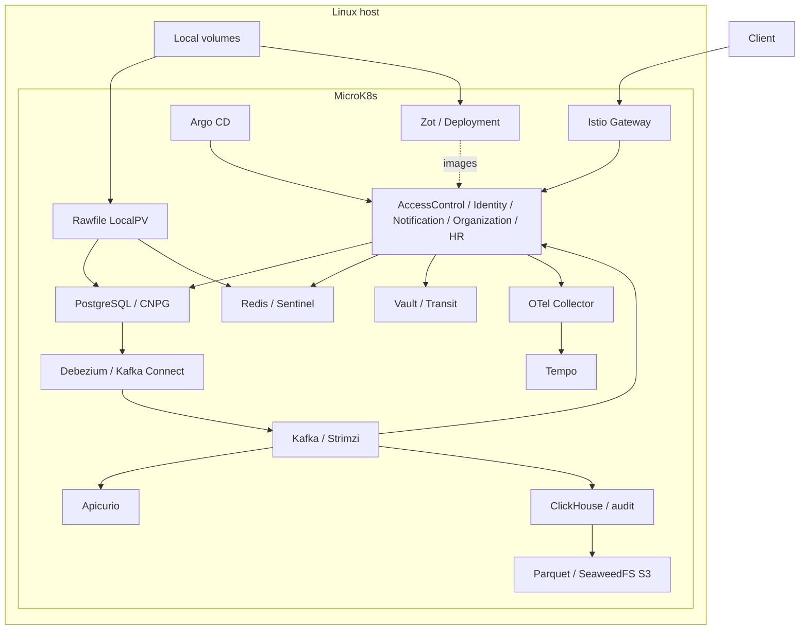

# @monadiam/stand-infrastructure

Language: **EN** | [RU](README.ru.md)

The MonadIAM DEV stand runs on one MicroK8s node. It hosts five API services, PostgreSQL/Redis, Kafka/Debezium, Vault, GitOps, and observability. The repository profile is `dev`.

You need a Linux host, `just`, Go 1.27, Terraform 1.17.1, kubectl, Helm, and Docker with daemon access. Application images target `linux/amd64`. Prepare MicroK8s and local volumes **before** `just start`. The host also needs access to image registries, Helm charts, Go modules, and Terraform providers, or working mirrors.

----

<details>
<summary><strong>What the stand includes</strong></summary>

DEV uses one Linux host. MicroK8s runs the platform and applications. Zot runs in Kubernetes and stores images on a host volume. Each of the five services has its own PostgreSQL and Redis. DEV has one instance of each database and one Kafka broker/controller.

> Automatic failover requires increasing the replica counts.



| Subsystem                                 | Purpose                                                         |
| :---------------------------------------- | :-------------------------------------------------------------- |
| Istio ambient and Gateway API             | External HTTPS routes, mTLS, and access policies                |
| CNPG, Redis/Sentinel                      | Service databases, permissions, sessions, and queues            |
| Strimzi, Kafka Connect/Debezium, Apicurio | CDC, events, and schemas                                        |
| Vault, cert-manager, VSO/ESO              | PKI, Transit, and secret delivery                               |
| ClickHouse, SeaweedFS                     | Ingest audit/change events from Kafka and archive Parquet to S3 |
| Argo CD, Image Updater                    | Applications and Git-driven image updates                       |
| Prometheus, Grafana, Loki, Tempo, OTel    | Metrics, logs, and traces                                       |

</details>

----

<details>
<summary><strong>Preparation and first start</strong></summary>

The `host` namespace is only for a new, empty Ubuntu 24.04 host with snap and systemd. Do not run it on an already prepared `linux` host.

- `host::storage` creates and formats new ext4 files.
- `host::install` creates a separate API encryption key on the host.

For another OS, host preparation depends on how MicroK8s and volumes are managed there. `just start` does not prepare the host.

**New Ubuntu host.** Inspect the network interface, free space, and installed tools. Choose volume sizes, the actual IP address, and the interface. The current DEV profile names its node `monadiam-dev`.

```sh
just host::inspect
just host::storage 320G 32G
just host::install 192.168.1.143
just host::calico wlo1
just host::limits
just host::verify
```

The `host::storage` command refuses to run if either volume file already exists. Its mount units are in `bootstrap/microk8s` and `bootstrap/zot`. The MicroK8s drop-in requires Rawfile to be mounted and puts services in `monadiam.slice`. The `host::install` command applies `clusters/dev/host/microk8s.yaml` using a separate key from `/etc/monadiam/microk8s/encryption.key`. Do not put the key or the rendered launch config containing it in Git. Installation and Calico interface settings follow the [MicroK8s launch config](https://canonical.com/microk8s/docs/add-launch-config) and [host interfaces](https://canonical.com/microk8s/docs/configure-host-interfaces) documentation.

**Configure the profile and start.** Check `KUBECONFIG`, `KUBE_CONTEXT`, `TF_STATE_DIR`, `VAULT_STATE_DIR`, and `APPLICATIONS_IP` in `.env.dev`. Addresses in `clusters/dev/applications/endpoints/kustomization.yaml` and OAuth redirect URIs in `clusters/dev/applications/identity/kustomization.yaml` must match the host IP.

```sh
just env::init
just env::check
just start
just status
just k8::diagnostics
```

If Zot is empty, first run `just k8::start` and `just zot::apply`, publish the images pinned in the overlays with `just zot::push`, then run `just start`. [GitOps and images](docs/GITOPS.md) describe the image flow.

`just start` starts MicroK8s, creates a working kubeconfig, applies Zot, Terraform, and the platform, then waits for five Deployments and successful `/docs/` responses on ports 4001-4005. Argo CD reads the remote `dev` branch. It does not apply uncommitted local application changes.

</details>

----

<details>
<summary><strong>Commands</strong></summary>

Just namespaces use names such as `k8::start`. `just k8 start` also works. Running `just` without arguments lists the available commands.

| Command                                                       | Action                                                              |
| :------------------------------------------------------------ | :------------------------------------------------------------------ |
| `just start`, `just resume`                                   | Start the stand and check all five services                         |
| `just stop`, `just restart`                                   | Stop or restart the stand                                           |
| `just status`, `just k8::diagnostics`                         | Inspect the platform, nodes, Pods, PVCs, and Events                 |
| `just k8::start`, `just k8::stop`, `just k8::status`          | Manage MicroK8s                                                     |
| `just zot::apply`, `just zot::status`, `just zot::logs`       | Manage the image registry                                           |
| `just env::init`, `just env::check`                           | Manage the environment file                                         |
| `just platform::reconcile <phase>`                            | Reconcile one platform phase                                        |
| `just platform::reconcile seaweedfs`                          | Reconcile SeaweedFS buckets, ClickHouse schema, and archive CronJob |
| `just tf::plan <root>`, `just tf::apply <root>`               | Manage a Terraform root                                             |
| `just vault::status`, `just vault::plan`, `just vault::apply` | Manage Vault                                                        |
| `just gitops::ui`, `just gitops::credentials`                 | Manage Argo CD                                                      |
| `just cli::build`, `just cli::lint`, `just cli::format`       | Build, lint, and format the Go CLI                                  |
| `just tf::validate`, `just k8::validate`                      | Validate Terraform and Kubernetes configuration                     |

> The `tf::apply` command uses Terraform `-auto-approve`. Run `tf::plan` before an individual apply.
> The optional Redis backup timer is managed with `host::redis-backup*` and is separate from stand startup.

</details>

----

## Navigation

- [Network, Istio, Gateway, and access](docs/NETWORK.md)
- [PostgreSQL, Redis, ClickHouse, and SeaweedFS](docs/DATA.md)
- [Kafka, Debezium, and Apicurio](docs/MESSAGING.md)
- [Vault, certificates, and secret delivery](docs/SECRETS.md)
- [GitOps, images, and updates](docs/GITOPS.md)
- [Resources, PVCs, and volumes](docs/RESOURCES.md)
