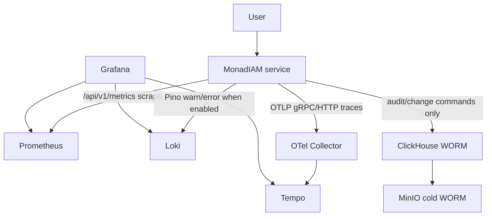

# @monadiam/local-infrastructure

Local Docker infrastructure for MonadIAM services.

This repository owns the shared local runtime: per-service PostgreSQL and Redis,
Kafka + Kafka Connect/Debezium, Vault, ClickHouse, MinIO, and a lightweight
application observability stack.

----

<details>
<summary><strong>Service Port Map</strong></summary>

| Index | Service          | HTTP APP_PORT | PostgreSQL host port | Redis host port |
|:------|:-----------------|:--------------|:---------------------|:----------------|
| `0`   | `template`       | `4000`        | `6000`               | `7000`          |
| `1`   | `access-control` | `4001`        | `6001`               | `7001`          |
| `2`   | `identity`       | `4002`        | `6002`               | `7002`          |
| `3`   | `notification`   | `4003`        | `6003`               | `7003`          |

Service containers use internal PostgreSQL port `5432` and Redis port `6379`.
Only the host-published ports above are service-indexed.

</details>

----

<details>
<summary><strong>Shared Ports</strong></summary>

| Component       | Host port | Container port | Variable                   |
|:----------------|:----------|:---------------|:---------------------------|
| Kafka UI        | `8080`    | `8080`         | `KAFKA_UI_PORT`            |
| Kafka Connect   | `8083`    | `8083`         | `KAFKA_CONNECT_PORT`       |
| Schema Registry | `8081`    | `8080`         | `SCHEMA_REGISTRY_PORT`     |
| Vault           | `8200`    | `8200`         | `VAULT_PUBLISHED_PORT`     |
| ClickHouse      | `9000`    | `9000`         | `CLICKHOUSE_NATIVE_PORT`   |
| ClickHouse      | `8123`    | `8123`         | `CLICKHOUSE_HTTP_PORT`     |
| MinIO API       | `9010`    | `9000`         | `MINIO_API_PORT`           |
| MinIO Console   | `9011`    | `9090`         | `MINIO_CONSOLE_PORT`       |
| Prometheus      | `9090`    | `9090`         | `PROMETHEUS_PORT`          |
| Grafana         | `3000`    | `3000`         | `GRAFANA_PORT`             |
| Loki            | `3100`    | `3100`         | `LOKI_PORT`                |
| Tempo           | `3200`    | `3200`         | `TEMPO_PORT`               |
| OTel Collector  | `4317`    | `4317`         | `OTEL_COLLECTOR_GRPC_PORT` |
| OTel Collector  | `4318`    | `4318`         | `OTEL_COLLECTOR_HTTP_PORT` |

</details>

----

<details>
<summary><strong>Structure</strong></summary>

| Path                                      | Owns                                             |
|:------------------------------------------|:-------------------------------------------------|
| `docker-compose.yml`                      | Root Compose include manifest                    |
| `services/template/compose.yml`           | Template PostgreSQL + Redis                      |
| `services/access-control/compose.yml`     | Access Control PostgreSQL + Redis                |
| `services/identity/compose.yml`           | Identity PostgreSQL + Redis                      |
| `services/notification/compose.yml`       | Notification PostgreSQL + Redis                  |
| `messaging/compose.yml`                   | Kafka, Kafka UI, Kafka Connect, Debezium init    |
| `audit-archive/compose.yml`               | ClickHouse, MinIO, archive init/job              |
| `observability/compose.yml`               | Prometheus, Grafana, Loki, Tempo, OTel Collector |
| `observability/prometheus/prometheus.yml` | Application metrics scrape config                |
| `observability/grafana/provisioning/`     | Datasources and dashboard provisioning           |
| `vault/compose.yml`                       | Vault server, init/unseal, local bootstrap       |
| `vault/config/vault.hcl`                  | Vault server config                              |
| `vault/policies/*.hcl`                    | Vault ACL policies                               |
| `messaging/debezium/*.connector.json`     | Debezium outbox connector template               |
| `scripts/*.sh`                            | Local bootstrap and init scripts                 |

</details>

----

<details>
<summary><strong>Service Infrastructure</strong></summary>

| Service          | PostgreSQL container        | Redis container        | PostgreSQL variables prefix | Redis variables prefix   |
|:-----------------|:----------------------------|:-----------------------|:----------------------------|:-------------------------|
| `template`       | `template-postgresql`       | `template-redis`       | `TEMPLATE_POSTGRES_*`       | `TEMPLATE_REDIS_*`       |
| `access-control` | `access-control-postgresql` | `access-control-redis` | `ACCESS_CONTROL_POSTGRES_*` | `ACCESS_CONTROL_REDIS_*` |
| `identity`       | `identity-postgresql`       | `identity-redis`       | `IDENTITY_POSTGRES_*`       | `IDENTITY_REDIS_*`       |
| `notification`   | `notification-postgresql`   | `notification-redis`   | `NOTIFICATION_POSTGRES_*`   | `NOTIFICATION_REDIS_*`   |

PostgreSQL containers run with logical replication enabled for Debezium: `wal_level=logical`, `max_replication_slots=10`, `max_wal_senders=10`.

</details>

----

<details>
<summary><strong>Observability</strong></summary>

`local` restores the application observability path without the heavier parts of
the `k3s` stand: no container, node, pod, or Kubernetes control-plane metrics,
and no auth/TLS/service-mesh layer around Grafana, Prometheus, Loki, Tempo, or
the OTel Collector. Published ports are bound to `127.0.0.1`.



Service compose projects must join `DOCKER_NETWORK_MONITORING=monitoring-net`.
Service `.env.local.example` files include the observability defaults:

```dotenv
OTEL_EXPORTER_OTLP_ENDPOINT="http://otel-collector:4317"
OTEL_LOGS_EXPORTER="none"
LOKI_ENABLED="true"
LOKI_URL="http://loki:3100"
LOKI_BATCH_INTERVAL="5"
```

Existing service `.env` files are not rewritten automatically. Add these
variables manually or recreate them from `.env.local.example`.

Grafana is available at `http://localhost:3000`; the provisioned home dashboard
is `MonadIAM Local Observability`. ClickHouse remains outside Grafana here:
audit/change logs are an investigation WORM path, not operational log storage.

</details>

----

<details>
<summary><strong>Vault</strong></summary>

| Service          | AppRole name             | Runtime KV path                       | Extra KV path               |
|:-----------------|:-------------------------|:--------------------------------------|:----------------------------|
| `template`       | `template-service`       | `kv/template-service/runtime`         |                             |
| `identity`       | `identity-service`       | `kv/identity-service/runtime`         | `kv/identity-service/oauth` |
| `notification`   | `notification-service`   | `kv/notification-service/runtime`     |                             |
| `access-control` | `access-control-service` | `kv/access-control-service/runtime`   |                             |

Runtime KV payloads contain static local credentials rendered by each service's
Vault Agent:

| Field                 | Used by                         |
|:----------------------|:--------------------------------|
| `postgresql_username` | Application runtime, migrations |
| `postgresql_password` | Application runtime, migrations |
| `redis_password`      | Application runtime, seeders    |

`identity-service/oauth` contains OAuth provider client secrets.

`notification-service/runtime` also contains AWS access key fields for local
SES/SNS configuration.

Vault Transit keys are created for audit masking/signing and identity token
operations. Service containers access Vault through their local Vault Agent Unix
listener and rendered secret files.

</details>

----

<details>
<summary><strong>Kafka and Debezium</strong></summary>

- `messaging/compose.yml` starts Kafka, Kafka UI, Schema Registry, Kafka Connect, and the Debezium connector bootstrap container.
- `scripts/kafka-init-topics.sh` creates platform topics and retry/dead-letter topics.
- `scripts/debezium-init-connectors.sh` registers outbox connectors.

Schema Registry runs on Apicurio Registry with KafkaSQL storage. Its internal
journal, snapshots, and events topics are created explicitly by
`scripts/kafka-init-topics.sh`; topic auto-creation is disabled in the registry
container. Registry readiness is checked through the Apicurio management
endpoint on the internal container port `9000`.

Global Schema Registry rules are configured through `.env`:

| Variable                               | Default    | Purpose                                      |
|:---------------------------------------|:-----------|:---------------------------------------------|
| `SCHEMA_REGISTRY_GLOBAL_VALIDITY`      | `FULL`     | Reject structurally invalid schema artifacts |
| `SCHEMA_REGISTRY_GLOBAL_COMPATIBILITY` | `BACKWARD` | Keep consumers compatible by default         |
| `SCHEMA_REGISTRY_GLOBAL_INTEGRITY`     | `FULL`     | Validate artifact references and integrity   |

| Service          | Connector name                            | PostgreSQL host                  |
|:-----------------|:------------------------------------------|:---------------------------------|
| `template`       | `template-service-outbox-connector`       | `template-postgresql:5432`       |
| `access-control` | `access-control-service-outbox-connector` | `access-control-postgresql:5432` |
| `identity`       | `identity-service-outbox-connector`       | `identity-postgresql:5432`       |
| `notification`   | `notification-service-outbox-connector`   | `notification-postgresql:5432`   |

</details>

----

<details>
<summary><strong>Commands</strong></summary>

| Makefile       | Description                                     |
|:---------------|:------------------------------------------------|
| `make env`     | Create `.env` from `.env.example`.              |
| `make up`      | Start local infrastructure with Docker Compose. |
| `make down`    | Stop and remove containers and networks.        |
| `make restart` | Run `make down` and `make up`.                  |
| `make stop`    | Stop containers without removing them.          |
| `make start`   | Start existing stopped containers.              |

Service repositories should be started after this infrastructure is healthy.

</details>

----
