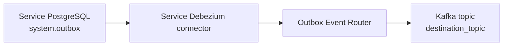

# @monadiam/stand-infrastructure

Platform | Stand Infrastructure: k3d/k3s, PostgreSQL/Redis, Kafka/Debezium messaging,
Vault secrets, ClickHouse, SeaweedFS archive storage, Go tooling and observability
with Prometheus, Grafana, Loki and Tempo.

> If your machine has insufficient CPU or memory, switch to the `local` branch.
> It provides a less resource-intensive setup using Docker Compose.

### Requirements

- **Make** — runs the prepared project commands from `Makefile`, such as `make start`.
- **Go 1.27+** — builds and runs the CLI, checks and tests on the host.
- **Docker** — runs containers with k3s nodes; Docker must be running.
- **k3d** — creates and manages the Kubernetes cluster based on k3s.
- **kubectl and Helm** — apply manifests, install components and check readiness.
- **Network access** — required to download images, Helm charts and Gateway API manifests.

### Quick Start

Run from the repository root:

```bash
make env
```

Review `.env`, especially `CLUSTER`, `KUBE_CONTEXT` and `VAULT_INIT_FILE`.
Then validate the configuration and start the stand:

```bash
make env-check
make start
make status
```

`make start` creates or starts the cluster, installs platform components and waits
for them to become ready, including AccessControl. External routes are configured separately.

> - `make env` preserves an existing `.env`.
> - Use `make resume` to start a stopped stand and `make stop` to stop it.
> - `make recreate` deletes the cluster before creating a new one; data may be lost.

----

<details>
<summary><strong>Service mesh (Istio)</strong></summary>

| Setting              | Value                                                                                    |
| :------------------- | :--------------------------------------------------------------------------------------- |
| Dataplane            | Ambient: Istio CNI + one ztunnel per node; no application sidecars                       |
| Version              | All four Helm releases use `ISTIO_VERSION`                                               |
| Platform             | `global.platform=k3d`; CNI binaries: `/var/lib/rancher/k3s/data/cni`                     |
| Transport            | TCP over HBONE/mTLS; namespace `PeerAuthentication` requires `STRICT`                    |
| Workload identity    | `spiffe://cluster.local/ns/<namespace>/sa/<service-account>`                             |
| Certificates         | Issued by Istiod; ztunnel requests 24h certificates and renews them before expiry        |
| Certificate settings | `helm/ztunnel-values.yaml`: `SECRET_TTL`; `helm/istiod-values.yaml`: default/maximum TTL |
| Application access   | Database roles, passwords and Kafka ACL remain required; mesh identity is additional     |

Paths in this section are relative to `infrastructure/networking/istio/`.
Certificate renewal does not require restarting application pods. The Istio CA is separate
from the cert-manager CA used by native component TLS; workload renewal does not rotate the root CA.

| Namespace scope                                                                           | Protection / exception                                          |
| :---------------------------------------------------------------------------------------- | :-------------------------------------------------------------- |
| `monadiam-apps`, `monadiam-data`, `monadiam-messaging`, `monadiam-observability`          | Ambient + mandatory mTLS for captured TCP traffic               |
| `vault`, `vault-secrets-operator`, `cnpg-system`, `strimzi-system`, `clickhouse-operator` | Ambient + mandatory mTLS for captured TCP traffic               |
| CNPG webhook `9443`, Prometheus operator webhook `10250`                                  | Native HTTPS; API server is outside mesh                        |
| `istio-ingress`                                                                           | Gateway proxy; external HTTPS and internal mesh connections     |
| `kube-system`, `cert-manager`, `istio-system`, host-network pods                          | Control plane / node infrastructure; outside ambient enrollment |
| UDP, including DNS                                                                        | Not covered by Istio mTLS                                       |

Namespace enrollment is declared in `clusters/local/namespaces.yaml`. `resources/network-policy.yaml`
allows HBONE (`15008/TCP`) through the Kafka and SeaweedFS network policies. New application workloads
must use dedicated ServiceAccounts; per-service `AuthorizationPolicy` rules belong with their deployments.
Native PostgreSQL, Redis, Kafka and Vault TLS remains enabled.

```text
Gateway API CRDs -> istio-base -> istiod -> istio-cni -> ztunnel -> mesh policies
application -> ztunnel == mTLS == ztunnel -> destination
```

```sh
make reconcile COMPONENT=istio
kubectl -n istio-system get deployments,daemonsets,pods
kubectl get peerauthentication -A
```

References: [Ambient installation](https://istio.io/latest/docs/ambient/install/helm/),
[k3d prerequisites](https://istio.io/latest/docs/ambient/install/platform-prerequisites/#k3d),
[mTLS verification](https://istio.io/latest/docs/ambient/usage/verify-mtls-enabled/).

</details>

----

<details>
<summary><strong>Commands</strong></summary>

| Makefile            | CLI                                              | Purpose                                                 |
| :------------------ | :----------------------------------------------- | :------------------------------------------------------ |
| **Infrastructure**  |                                                  |                                                         |
| `make env`          | `infra config init`                              | Create `.env` if it does not exist.                     |
| `make start`        | `infra cluster start`                            | Create or start the cluster and configure the platform. |
| `make resume`       | `infra cluster resume`                           | Start and configure an existing cluster.                |
| `make stop`         | `infra cluster stop`                             | Stop the cluster without deleting it.                   |
| `make restart`      | `infra cluster restart`                          | Restart the cluster and apply configuration.            |
| `make recreate`     | `infra cluster recreate --confirm-delete`        | Delete and recreate the cluster.                        |
| `make status`       | `infra cluster status`                           | Show nodes, releases and resources.                     |
| **Development**     |                                                  |                                                         |
| `make build`        | —                                                | Build the executable at `build/infra`.                  |
| `make lint`         | —                                                | Run golangci-lint and gofmt checks.                     |
| `make lint-fix`     | —                                                | Apply gofmt formatting.                                 |
| `make env-check`    | `infra config validate`                          | Validate settings without network calls.                |
| **Platform**        |                                                  |                                                         |
| `make reconcile`    | `infra platform reconcile`                       | Update the running platform configuration.              |
| `make vault-status` | `infra vault status`                             | Show Vault status and the unseal key threshold.         |
| `make seaweedfs`    | `infra platform reconcile --component seaweedfs` | Apply SeaweedFS and bucket configuration.               |
| —                   | `infra seaweedfs reconcile`                      | Configure buckets inside the bootstrap Job.             |
| **Tests**           |                                                  |                                                         |
| `make utest`        | —                                                | Run Ginkgo tests with the race detector, without k3s.   |
| `make itest`        | —                                                | Test the platform in an isolated k3d cluster.           |

**CLI Options**

| Option             | Purpose                                                |
| :----------------- | :----------------------------------------------------- |
| `--env-file`       | Dotenv path; an empty value disables file loading.     |
| `--timeout`        | Total timeout, e.g. `60m`; not used by `config init`.  |
| `--component`      | Component for `platform reconcile`; defaults to `all`. |
| `--confirm-delete` | Allow deletion for `cluster recreate`.                 |
| `--help`           | General or command-specific help.                      |

Components available for selective reconciliation: `images`, `cert-manager`, `metrics-server`,
`istio`, `gateway`, `vault`, `operators`, `clusters`, `apicurio`, `schemas`, `seaweedfs`, `observability`.

> - Makefile is the main entry point. To run the CLI directly, use
>   `go run . <component> <action> [options]`; for help, use `go run . --help`.
> - Select an environment file through `ENV_FILE`:
>   `make env-check ENV_FILE=.env.example`.
> - `make reconcile COMPONENT=seaweedfs` applies only the selected component;
>   its dependencies must already be configured by a full platform startup.
> - Single-quote dotenv values containing `$`.
> - Integration tests cover initialization, S3 permissions, repeated reconciliation
>   and restarts with data persistence. The test cluster and registry are removed;
>   the JSON report is saved to `build/integration-report.json`.

</details>

----

<details>
<summary><strong>Tests</strong></summary>

| Layer       | Location                          | Scope                                      |
| :---------- | :-------------------------------- | :----------------------------------------- |
| Unit        | `cli/*_test.go`                   | Commands, arguments and errors.            |
| Unit        | `cli/config/*_test.go`            | Configuration loading and validation.      |
| Unit        | `cli/platform/*/*_test.go`        | Component operations and command ordering. |
| Integration | `cli/tests/integration/*_test.go` | Real components in an isolated k3d stand.  |

| Label        | Test file            | Scenarios                                                      |
| :----------- | :------------------- | :------------------------------------------------------------- |
| `bootstrap`  | `bootstrap_test.go`  | Vault initialization, credentials and persistent storage.      |
| `postgresql` | `postgresql_test.go` | Six clusters, TLS, roles, isolation, replication and recovery. |
| `redis`      | `redis_test.go`      | Six groups, mTLS, isolation, Sentinel quorum and recovery.     |
| `lifecycle`  | `lifecycle_test.go`  | Reconcile, restart and deletion protection; PG/Redis/S3 data.  |
| `seaweedfs`  | `seaweedfs_test.go`  | Versioning, retention and access restrictions.                 |
| `failover`   | PostgreSQL and Redis | Primary and replica failures, writes and restored replication. |

```bash
make utest
make itest
make itest FILTER=postgresql
make itest FILTER=redis
make itest FILTER='redis && failover'
make itest FILTER='(postgresql || redis) && !failover'
```

Integration runs always create and delete their own stand, including when filtered.
Run sequentially; Ginkgo parallel execution is rejected. Reports are saved to
`build/integration-report.json`.

Failure tests wait for marker replication, cordon the affected node and delete one
pod. Cleanup uncordons the node and waits for workload recovery. These checks cover
pod failures within one machine; replication remains asynchronous.

PostgreSQL uses `pgx`; Redis uses `go-redis` with Sentinel discovery. Kubernetes
port forwards provide transport and preserve TLS hostname verification. These tests
do not validate application deployment, cluster DNS or network policies.

</details>

----

<details>
<summary><strong>Structure</strong></summary>

```text
stand/
+-- Makefile                             # Cluster, platform and development commands
+-- .env.example                         # Environment settings and component versions
+-- main.go                              # CLI entry point and shutdown handling
+-- go.mod                               # Go module and dependencies
+-- go.sum                               # Dependency checksums
|
+-- cli/                                 # Go application and component tests
|   +-- cli.go                           # Command-line arguments
|   +-- commands.go                      # Command handlers and application state
|   +-- types.go                         # Handler type and help text
|   +-- config/                          # Configuration loading, creation and validation
|   +-- platform/
|   |   +-- command/                     # Subprocess execution and readiness polling
|   |   +-- helm/                        # Chart installation and retries
|   |   +-- kubernetes/                  # Context, manifests and resource readiness
|   |   +-- seaweedfs/                   # Buckets, versioning and retention rules
|   |   +-- stand/                       # Cluster and platform component management
|   |   +-- vault/                       # Initialization, unseal and secret configuration
|   +-- tests/integration/               # Tests against a real k3d cluster
|       +-- cluster_helpers.go           # Test environment management
|       +-- platform_helpers.go          # Resource snapshots, credentials and Vault
|       +-- seaweedfs_helpers.go         # S3 settings
|       +-- storage_helpers.go           # S3 client and object checks
|       +-- integration_test.go          # Shared isolated stand and cleanup
|       +-- bootstrap_test.go            # Vault and synchronized credentials
|       +-- lifecycle_test.go            # Reconcile, restart and deletion protection
|       +-- seaweedfs_test.go            # Archive permissions and retention
|       +-- postgresql_test.go           # PostgreSQL access, replication and failover
|       +-- postgresql_helpers.go        # pgx client and service connections
|       +-- redis_test.go                # Redis access, Sentinel and failover
|       +-- redis_helpers.go             # go-redis client and Sentinel discovery
|       +-- failure_helpers.go           # Pod failures and recovery
|       +-- testdata/                    # Isolated ports and test registry
|
+-- bootstrap/k3d/cluster.yaml           # k3s nodes, registry and host ports
+-- clusters/local/                      # Namespaces and storage configuration
+-- infrastructure/
|   +-- networking/                      # Istio and Gateway API
|   +-- security/                        # cert-manager and Vault Secrets Operator
|   +-- operators/                       # CloudNativePG, Strimzi and ClickHouse Operator
|   +-- observability/                   # Prometheus, Grafana, Loki, Tempo and OTel
|   +-- storage/                         # Storage class with the Retain policy
+-- platform/
    +-- postgresql/                      # CNPG clusters and monitoring
    +-- redis/                           # Redis/Sentinel values and TLS certificates
    +-- kafka/                           # Broker, Connect, topics and outbox connector
    +-- apicurio/                        # Registry, KafkaSQL, credentials and schema publication
    +-- clickhouse/                      # ClickHouse cluster and monitoring
    +-- seaweedfs/                       # Helm values, bootstrap Job and S3 policies
    +-- vault/                           # Server, certificates and access policies
    +-- secrets/contract.yaml            # Vault paths and corresponding Secrets
```

</details>

----

<details>
<summary><strong>Ports and Access</strong></summary>

Host bindings are defined in `bootstrap/k3d/cluster.yaml`.

| Component      | Host address                   | Purpose                     |
| :------------- | :----------------------------- | :-------------------------- |
| Kubernetes API | `127.0.0.1:6550`                | Cluster management.         |
| Gateway HTTP   | `127.0.0.1:8080`                | HTTP ingress.               |
| Gateway HTTPS  | `127.0.0.1:8443`                | Domain-based HTTPS ingress. |
| Applications   | `<APPLICATIONS_IP>:4000–4005`   | HTTPS API and Scalar.       |
| Registry       | `127.0.0.1:5001`                | Images for the k3d cluster. |

Ports `8080`/`8443` accept `monadiam.localhost` and `*.monadiam.localhost`.
Ports `4000–4005` route to applications by port, using an IP certificate.
Grafana, Vault and other administrative interfaces require port forwarding.

For local access, forward a port from the required resource. Grafana example
using the default context:

```bash
kubectl --context k3d-monadiam -n monadiam-observability \
  port-forward deployment/kube-prometheus-stack-grafana 3000:3000
```

Open `http://localhost:3000` while the command is running. If you changed
`KUBE_CONTEXT` in `.env`, use that value instead of `k3d-monadiam`.

</details>

----

<details>
<summary><strong>Service Infrastructure</strong></summary>

Default k3d topology: one server + one worker on the same host.

| Namespace                | Components                               |
| :----------------------- | :--------------------------------------- |
| `monadiam-data`          | PostgreSQL, Redis, ClickHouse, SeaweedFS |
| `monadiam-messaging`     | Kafka, Kafka Connect, Apicurio           |
| `monadiam-observability` | Metrics, logs, traces, Grafana           |
| `vault`                  | Vault                                    |
| `monadiam-apps`          | Applications; deployed separately        |

| Component  | Configuration                                                |
| :--------- | :----------------------------------------------------------- |
| PostgreSQL | Six CNPG clusters; one primary + one replica each            |
| Redis      | Six releases; one primary + two replicas; three Sentinel      |
| Storage    | `local-path-retain`; retained volumes require manual cleanup |

[Platform manifests](platform/) / [Operators](infrastructure/operators/) / [Secrets contract](platform/secrets/contract.yaml)

**PostgreSQL**

Namespace: `monadiam-data`. Database name: `<service>-service`.

| Service          | Cluster / manifest                             | Database owner   |
| :--------------- | :--------------------------------------------- | :--------------- |
| `access-control` | [access-control-postgresql][pg-access-control] | `access_control` |
| `identity`       | [identity-postgresql][pg-identity]             | `identity`       |
| `notification`   | [notification-postgresql][pg-notification]     | `notification`   |
| `organization`   | [organization-postgresql][pg-organization]     | `organization`   |
| `hr`             | [hr-postgresql][pg-hr]                         | `hr`             |
| `template`       | [template-postgresql][pg-template]             | `template`       |

[pg-access-control]: platform/postgresql/resources/access-control-postgresql.yaml
[pg-identity]: platform/postgresql/resources/identity-postgresql.yaml
[pg-notification]: platform/postgresql/resources/notification-postgresql.yaml
[pg-organization]: platform/postgresql/resources/organization-postgresql.yaml
[pg-hr]: platform/postgresql/resources/hr-postgresql.yaml
[pg-template]: platform/postgresql/resources/template-postgresql.yaml

| Parameter                      | Value                                                     |
| :----------------------------- | :-------------------------------------------------------- |
| Write host                     | `<cluster>-rw.monadiam-data.svc.cluster.local`            |
| Read host                      | `<cluster>-ro.monadiam-data.svc.cluster.local`            |
| Port                           | `5432`                                                    |
| Data / WAL per instance        | `8Gi` / `1Gi`                                             |
| CPU / RAM request per instance | `100m` / `256Mi`                                          |
| RAM limit per instance         | `1Gi`                                                     |
| Default total                  | 12 Pods; 24 PVCs; `108Gi` requested storage               |
| Application Secret             | `<cluster>-app`: `username`, `password`                   |
| CDC Secret                     | `<cluster>-debezium`: `username`, `password`              |
| Vault KV path                  | `kv/monadiam-data/postgresql/<service>/{app,debezium}`    |
| Credentials lifecycle          | Vault -> VSO -> CNPG; preserved on reconcile              |
| Database owner                 | Non-superuser; remote superuser access disabled           |
| CDC role                       | `debezium`; `LOGIN`, `REPLICATION`, owner-role membership |
| Application TLS                | `verify-full`; CA: `<cluster>-ca`, key `ca.crt`           |

> Deliver only the public CA certificate to applications. Plaintext connections are rejected.
> `local-path` PVC sizes are requests, not enforced disk quotas.

**Replica count**

Edit `spec.instances` in each cluster manifest. `replicas = instances - 1`.

| `spec.instances` | Primary | Replicas | Read endpoint             |
| :--------------- | ------: | -------: | :------------------------ |
| `1`              |       1 |        0 | `-rw`; no `-ro` endpoints |
| `2` (default)    |       1 |        1 | `-ro`                     |
| `3`              |       1 |        2 | `-ro`                     |

```bash
# Apply persisted replica counts. Replace context if KUBE_CONTEXT differs.
kubectl --context k3d-monadiam apply -k platform/postgresql/resources

# Wait until READY == DESIRED and Pods are ready.
kubectl --context k3d-monadiam -n monadiam-data get clusters.postgresql.cnpg.io \
  -o custom-columns=NAME:.metadata.name,DESIRED:.spec.instances,READY:.status.readyInstances

# Temporary override; the next reconcile restores the manifest value.
kubectl --context k3d-monadiam -n monadiam-data patch cluster/template-postgresql \
  --type=merge -p '{"spec":{"instances":3}}'
```

| Constraint              | Behaviour                                                             |
| :---------------------- | :-------------------------------------------------------------------- |
| Persistent scaling      | Edit cluster manifests; no `.env` override                            |
| Read-after-write        | Use `-rw`; asynchronous replicas can lag                              |
| Availability            | Primary failover; no protection against physical host loss            |
| Backups                 | Replicas and `Retain` do not replace backups                          |
| Existing PVC expansion  | `local-path-retain` has no configured expansion support               |
| Application integration | Migrations, credential delivery and CDC activation are separate steps |

**Legacy `postgresql-main` cleanup**

For existing stands only. Export required data before deletion; `apply` does not prune removed resources.

```bash
kubectl --context k3d-monadiam -n monadiam-messaging delete kafkaconnector \
  postgresql-main-outbox --ignore-not-found
kubectl --context k3d-monadiam -n monadiam-data delete vaultstaticsecret \
  postgresql-main-app postgresql-main-debezium postgresql-main-superuser --ignore-not-found
kubectl --context k3d-monadiam -n monadiam-data delete cluster.postgresql.cnpg.io \
  postgresql-main --ignore-not-found
kubectl --context k3d-monadiam -n monadiam-data delete podmonitor postgresql-main --ignore-not-found
kubectl --context k3d-monadiam -n monadiam-data delete secret \
  postgresql-main-app postgresql-main-debezium postgresql-main-superuser --ignore-not-found
kubectl --context k3d-monadiam -n monadiam-data delete pvc -l cnpg.io/cluster=postgresql-main
```

| Resource           | Action                                                                   |
| :----------------- | :----------------------------------------------------------------------- |
| Released PVs       | Retained; inspect before reclaiming disk space                           |
| Vault KV           | Admin session: `vault kv delete kv/monadiam-data/postgresql/main/<role>` |
| Old Vault entries  | Repeat for `app`, `debezium`, `superuser`; history remains               |
| Kafka Connect RBAC | Keep; reapply the updated allowlist of six CDC Secrets                   |

**Redis / Sentinel**

Namespace: `monadiam-data`. One release per service, installed directly from the upstream chart.
Topology follows [Redis Sentinel](https://redis.io/docs/latest/operate/oss_and_stack/management/sentinel/) and [GitLab replication/failover](https://docs.gitlab.com/administration/redis/replication_and_failover/#example-of-a-minimal-configuration-with-1-primary-2-replicas-and-3-sentinels).

| Service          | Release / Sentinel master set | Values                                                                  |
| :--------------- | :---------------------------- | :---------------------------------------------------------------------- |
| `access-control` | `access-control-redis`        | [access-control.yaml](platform/redis/helm/services/access-control.yaml) |
| `identity`       | `identity-redis`              | [identity.yaml](platform/redis/helm/services/identity.yaml)             |
| `notification`   | `notification-redis`          | [notification.yaml](platform/redis/helm/services/notification.yaml)     |
| `organization`   | `organization-redis`          | [organization.yaml](platform/redis/helm/services/organization.yaml)     |
| `hr`             | `hr-redis`                    | [hr.yaml](platform/redis/helm/services/hr.yaml)                         |
| `template`       | `template-redis`              | [template.yaml](platform/redis/helm/services/template.yaml)             |

```text
<service>-redis
  node-0: Redis + Sentinel + exporter -> Kubernetes node A
  node-1: Redis + Sentinel + exporter -> Kubernetes node B
  node-2: Redis + Sentinel + exporter -> Kubernetes node C

1 primary + 2 replicas; roles can change
Sentinel quorum 2/3 -> elect primary -> client reconnects
```

| Parameter           | Default                                                                    |
| :------------------ | :------------------------------------------------------------------------- |
| Redis / Sentinel    | 3 Redis; 3 Sentinel; quorum 2; majority 2                                  |
| Redis data          | AOF enabled; `1Gi` PVC per Redis pod                                       |
| Sentinel state      | `100Mi` PVC per pod; persists topology and epochs                          |
| Total, six releases | 18 pods; 36 active PVCs; `18Gi + 1800Mi`; RAM request/limit `7680/16896Mi` |
| Failure detection   | `10s`; election and reconnect add time; failover timeout `180s`            |
| Placement           | Hard anti-affinity; 3 schedulable Kubernetes nodes required                |
| Evictions           | PDB `minAvailable: 2`; protects against voluntary disruptions              |
| Monitoring          | Exporter on each pod; Redis and Sentinel metrics                           |
| Write safety        | At least 1 replica with lag <= 10s; otherwise Redis rejects writes         |
| Durability          | Asynchronous replication can lose recent writes; AOF is not a backup       |

k3d uses 1 server + 2 agents on one host. Redis tolerates loss of one pod or k3d node.
The stand targets recovery inside this host; physical host redundancy is outside its scope.

Values below are per container; CPU limits are unset.

| Container             | CPU request | RAM request | RAM limit | Redis maxmemory |
| :-------------------- | ----------: | ----------: | --------: | --------------: |
| Redis, other services | `100m`      | `256Mi`     | `512Mi`   | `256Mi`         |
| Redis, AccessControl  | `150m`      | `512Mi`     | `1536Mi`  | `768Mi`         |
| Sentinel / exporter   | `25m`       | `64Mi`      | `128Mi`   | —               |

`maxmemory-policy=noeviction` rejects writes at the data limit. RAM limits leave headroom for replication and AOF rewrite.
PVCs use `local-path-retain`; sizes are requests, not enforced disk quotas.

| Source                                                        | Purpose                                              |
| :------------------------------------------------------------ | :--------------------------------------------------- |
| `.env`: `REDIS_CHART`, `REDIS_CHART_VERSION`                  | Upstream OCI chart; pinned version `28.0.0`          |
| [values.yaml](platform/redis/helm/values.yaml)                | Shared topology, TLS, resources, image digests       |
| [services/](platform/redis/helm/services/)                    | Per-service names, secrets, AccessControl resources  |
| [resources/](platform/redis/resources/)                       | cert-manager certificates                            |

Helm downloads the chart during installation. No local chart, dependency build or custom Sentinel scripts.
Bitnami catalog availability is governed by [its distribution policy](https://github.com/bitnami/charts/issues/35164); pinned image digests do not guarantee registry retention.

**Connection contract**

`<release>` is the name from the table above. Applications need a Sentinel-aware client.

| Setting                    | Value                                                                                   |
| :------------------------- | :-------------------------------------------------------------------------------------- |
| Sentinel discovery service | `<release>.monadiam-data.svc.cluster.local:26379`                                       |
| Sentinel master set        | `<release>`                                                                             |
| Redis port                 | `6379`; obtain the current primary from Sentinel                                        |
| Auth                       | `<release>-auth`, key `redis-password`; used for Redis and Sentinel                     |
| Vault KV                   | `kv/monadiam-data/redis/<service>/auth`                                                 |
| TLS / mTLS                 | `<release>-tls`: `ca.crt`, `tls.crt`, `tls.key`; required on both ports                 |
| Generic Redis service      | `<release>:6379` selects all three Redis pods; unsuitable as a write endpoint           |
| Application integration    | Sentinel client setup and secret delivery to application namespaces are separate work   |

For clients accepting multiple Sentinel seeds, use all three addresses with port `26379`:

```text
<release>-node-0.<release>-headless.monadiam-data.svc.cluster.local
<release>-node-1.<release>-headless.monadiam-data.svc.cluster.local
<release>-node-2.<release>-headless.monadiam-data.svc.cluster.local
```

**Replica count**

Edit [shared values](platform/redis/helm/values.yaml), or override in the service values.
In Sentinel mode, `replica.replicaCount` includes the primary; every Redis pod contains a Sentinel.

| Parameter                             | Default | Example expansion |
| :------------------------------------ | ------: | ----------------: |
| `replica.replicaCount`                | 3       | 5                 |
| Redis primary / replicas              | 1 / 2   | 1 / 4             |
| Total Sentinel                        | 3       | 5                 |
| `sentinel.quorum`                     | 2       | 3                 |
| `replica.pdb.minAvailable`            | 2       | 3                 |
| Required schedulable Kubernetes nodes | 3       | 5                 |

```bash
# Existing two-node stands: add an agent once; fresh installs use bootstrap/k3d/cluster.yaml.
k3d node create monadiam-agent-1 --cluster monadiam --role agent --wait

# Ensure REDIS_CHART and REDIS_CHART_VERSION are present in .env.
# Also reconciles PostgreSQL, Kafka and ClickHouse.
make reconcile COMPONENT=clusters
```

Keep at least three pods. For N voters, set quorum and PDB minimum to `floor(N/2) + 1`.
Scaling down also requires removing departed Sentinel peers with `SENTINEL RESET <release>`, one surviving Sentinel at a time, allowing peer discovery between resets.

**Legacy `redis-main` cleanup**

For existing stands, migrate required data and switch clients before cleanup. Reconcile does not remove the old release.

```bash
helm --kube-context k3d-monadiam uninstall redis-main -n monadiam-data
kubectl --context k3d-monadiam -n monadiam-data delete vaultstaticsecret redis-main-auth --ignore-not-found
kubectl --context k3d-monadiam -n monadiam-data delete certificate redis-main-tls --ignore-not-found
kubectl --context k3d-monadiam -n monadiam-data delete secret redis-main-auth redis-main-tls --ignore-not-found
```

| Retained resource | Cleanup after migration                                                                            |
| :---------------- | :------------------------------------------------------------------------------------------------- |
| Redis PVCs / PVs  | Inspect claims with `app.kubernetes.io/instance=redis-main`; delete manually when no longer needed |
| Vault KV          | Admin session: `vault kv delete kv/monadiam-data/redis/main/auth`; history remains                 |


</details>

----

<details>
<summary><strong>Vault</strong></summary>

During platform setup, the CLI installs, initializes and unseals Vault, creates the
KV store and configures Kubernetes authentication. After a restart, the CLI unseals
Vault using the saved keys.

| Setting               | Purpose                                               |
| :-------------------- | :---------------------------------------------------- |
| `VAULT_STATE_DIR`     | Vault state directory on the machine running the CLI. |
| `VAULT_INIT_FILE`     | JSON file containing the root token and unseal keys.  |
| `VAULT_KEY_SHARES`    | Number of key shares created during initialization.   |
| `VAULT_KEY_THRESHOLD` | Number of key shares required to unseal Vault.        |

By default, keys and the root token are written to `/tmp/monadiam/k3s/vault/init.json`.
Directory permissions are set to `0700`, and file permissions to `0600`.

Vault Secrets Operator copies data from KV v2 into Kubernetes Secrets.
Secret paths, fields, access roles and consuming components are described in
`platform/secrets/contract.yaml`; access policies are stored in `platform/vault/bootstrap/`.
Existing credentials are preserved when configuration is reapplied.

> `VAULT_INIT_FILE` is required to unseal Vault again. For a long-lived stand,
> set `VAULT_STATE_DIR` and `VAULT_INIT_FILE` to locations outside `/tmp`.

</details>

----

<details>
<summary><strong>Kafka and Debezium</strong></summary>

Namespace: `monadiam-messaging`. One Kafka Connect deployment; six PostgreSQL connectors.



| Resource        | Configuration                                                    |
| :-------------- | :--------------------------------------------------------------- |
| Kafka broker    | [Broker][kafka-broker] / [Topics][kafka-topics]; TLS + SCRAM     |
| Kafka Connect   | [Worker and Debezium image build][kafka-connect]; local registry |
| Secret access   | [RBAC][kafka-pg-rbac]; `get` on six CDC Secrets only             |
| Connectors      | [Manifest directory][kafka-resources]                            |
| Schema Registry | [Apicurio 3.3.2](platform/apicurio/); KafkaSQL storage           |

[kafka-broker]: platform/kafka/resources/kafka-main.yaml
[kafka-topics]: platform/kafka/resources/kafka-main-topics.yaml
[kafka-connect]: platform/kafka/resources/kafka-connect.yaml
[kafka-pg-rbac]: platform/kafka/resources/kafka-connect-postgresql-secret-reader.yaml
[kafka-resources]: platform/kafka/resources/

| Connector                          | Database                 |
| :--------------------------------- | :----------------------- |
| `access-control-postgresql-outbox` | `access-control-service` |
| `identity-postgresql-outbox`       | `identity-service`       |
| `notification-postgresql-outbox`   | `notification-service`   |
| `organization-postgresql-outbox`   | `organization-service`   |
| `hr-postgresql-outbox`             | `hr-service`             |
| `template-postgresql-outbox`       | `template-service`       |

| Connector parameter  | Value                                                                    |
| :------------------- | :----------------------------------------------------------------------- |
| PostgreSQL endpoint  | Service cluster `-rw`, port `5432`                                       |
| Credentials          | `<service>-postgresql-debezium` Secret                                   |
| Capture              | `system.outbox`; `pgoutput`                                              |
| Slot / publication   | `<service>_postgresql_outbox_{slot,publication}`; hyphens -> underscores |
| Publication creation | Automatic, filtered to the outbox table                                  |
| First start          | `snapshot.mode: no_data`; stream new changes; no historical row snapshot |
| Default state        | `stopped`; activate after service migrations                             |
| Topic                | `destination_topic`                                                      |
| Key / event ID       | `id`                                                                     |
| Message              | `{ "actionType": ..., "payload": ... }`                                  |
| Projection partition | `payload.realm`; `PROJECTION_JOURNAL_PARTITIONS`                         |
| Realm partition      | `payload.realm`; `REALM_PARTITIONS`                                      |
| Position partition   | `payload.input.organization`; `POSITION_PARTITIONS`                      |
| Producer             | Idempotence enabled; one in-flight request per connection                |
| PostgreSQL TLS       | `require`: encrypted; server identity not verified                       |

[local-topics]: ../local/cli/platform/kafka/definitions.go
[local-outbox]: ../local/messaging/debezium/outbox.connector.json

Outbox output is named `monadiam.outbox.Envelope` with Kafka `SetSchemaMetadata`
before `PartitionRouting`; otherwise Debezium skips routing. JSON values and UUID keys stay unchanged.

**Topic contract**

| Setting            | Value                                                                                               |
| :----------------- | :-------------------------------------------------------------------------------------------------- |
| Source             | [Local topics][local-topics] / [outbox template][local-outbox]                                      |
| Partition defaults | `REALM_PARTITIONS=4`, `POSITION_PARTITIONS=4`, `PROJECTION_JOURNAL_PARTITIONS=4`; other topics: `1` |
| Retention          | Events and archives: `72h`; dead letters: `30d`; dispatch retry and blacklist dead letters: `7d`    |
| Short retention    | `reauthentication`: `30m`; `blacklist`: `15m`, `compact,delete`                                     |
| Retry              | `message-dispatch-retry-notification-service`; other consumers use inline retries                   |
| Legacy topics      | `membership*`, old `*-retry`; removed from manifests, retained in existing clusters                 |
| Connect storage    | `connect-configs`, `connect-offsets`, `connect-status`: `compact`                                   |
| Schema Registry    | `kafkasql-journal`, `kafkasql-snapshots`, `registry-events`: unlimited retention                    |

Existing `.env` files need `REALM_PARTITIONS` and `POSITION_PARTITIONS`.
Before applying to an existing stand, compare partition counts and data: changing
realm/position partition counts changes key routing. Migrate populated topics explicitly;
do not decrease partitions or delete topics/offsets to reconcile configuration.

Stand keeps TLS/SCRAM, CNPG endpoints and `publication.autocreate.mode=filtered`.
Unlike local's `all_tables`, filtered publications work with the scoped Debezium role.
`no_data` affects first initialization; existing offsets continue to be used.
Activate a new connector before producing events that must be delivered.

**Activation per service**

1. Run migrations as the database owner; create `system.outbox`.
2. Set `spec.state: running` in the connector manifest.
3. Apply, check connector/task status, verify an outbox event in Kafka.

```bash
# CLI renders partition counts; do not apply raw Kafka YAML.
make reconcile COMPONENT=clusters
kubectl --context k3d-monadiam -n monadiam-messaging get kafkaconnectors
```

| Operational constraint | Requirement                                                     |
| :--------------------- | :-------------------------------------------------------------- |
| `Ready` + `stopped`    | Configuration reconciled; no event delivery                     |
| Restarts               | Preserve Connect offsets and replication slots                  |
| Replayed events        | Consumers deduplicate by event ID                               |
| TLS `verify-full`      | Mount each CNPG public CA; set `database.sslrootcert`           |
| Primary failover       | Verify logical slot synchronization and CDC recovery separately |

[Debezium Outbox Event Router](https://debezium.io/documentation/reference/stable/transformations/outbox-event-router.html)

</details>

----

<details>
<summary><strong>Apicurio Schema Registry</strong></summary>

| Setting             | Value                                                                    |
| :------------------ | :----------------------------------------------------------------------- |
| Namespace / Service | `monadiam-messaging` / `schema-registry-main:8080`                       |
| Image               | `apicurio/apicurio-registry:3.3.2`; same version as local                |
| Replicas            | `1`; [deployment.yaml](platform/apicurio/resources/deployment.yaml)      |
| Resources           | Requests: `100m` CPU, `512Mi` RAM; RAM limit: `1Gi`; JVM heap: `512Mi`   |
| Storage             | KafkaSQL; existing Kafka PVC (`5Gi`); no separate database or PVC        |
| Kafka security      | TLS + SCRAM-SHA-512; dedicated user; ACLs for registry topics and groups |
| API access          | Internal HTTP, no authentication; no Gateway route                       |
| Native / compatible | `/apis/registry/v3` / `/apis/ccompat/v7`                                 |
| Rules               | Validity `FULL`; compatibility `BACKWARD`; integrity `FULL`              |
| Health              | Management port `9000`: `/health/ready`, `/health/live`                  |

KafkaSQL replays the journal on startup. All three registry topics use one partition,
one replica and unlimited retention. Monitor the shared Kafka disk usage.

| File / directory                                                                 | Purpose                                        |
| :------------------------------------------------------------------------------- | :--------------------------------------------- |
| [config/application.properties](platform/apicurio/config/application.properties) | Kafka connection, topic names and rules        |
| [kafka/topics.yaml](platform/apicurio/kafka/topics.yaml)                         | Journal, snapshots and events topics           |
| [kafka/user.yaml](platform/apicurio/kafka/user.yaml)                             | Strimzi user and scoped ACLs                   |
| [resources/](platform/apicurio/resources/)                                       | Deployment, probes and internal Service        |
| [apicurio.go](cli/platform/stand/apicurio.go)                                    | Kafka readiness, credentials, registry rollout |
| [apicurio_test.go](cli/platform/stand/apicurio_test.go)                          | Command ordering and failure propagation       |

```bash
# Included in make start/resume; apply separately after Kafka is ready.
make reconcile COMPONENT=apicurio

# Optional local API access.
kubectl --context k3d-monadiam -n monadiam-messaging \
  port-forward service/schema-registry-main 8085:8080
```

Config changes update the generated ConfigMap hash and trigger a rollout.
After rotating Kafka credentials or the CA, restart the registry deployment.

**Schema publication**

```text
images -> ... -> clusters -> apicurio -> schemas -> seaweedfs -> observability -> applications
```

| Setting        | Value                                                                                        |
| :------------- | :------------------------------------------------------------------------------------------- |
| Image          | `SHARED_SCHEMAS_IMAGE` in `.env`; `3.0.1` pinned by digest in [.env.example](.env.example)   |
| Preparation    | `images`: pull by digest, import with cache tag, register digest and verify CRI on each node |
| Scope          | `shared-schemas` and all application images; timeout: `IMAGE_PREPARE_TIMEOUT`                |
| Job            | `shared-schemas`; runs `scripts/apply.sh` after Apicurio readiness                           |
| Resources      | Requests: `50m` CPU, `32Mi` RAM; RAM limit: `128Mi`                                          |
| Failure        | No automatic retry; deadline 300s; CLI prints Job/Pod details and container logs             |
| Reconciliation | Recreates the Job; identical schemas keep their existing versions                            |
| Retention      | Finished Job and logs retained for 24h, or until the next reconciliation                     |

| File                                                             | Purpose                                       |
| :--------------------------------------------------------------- | :-------------------------------------------- |
| [schemas/job.yaml](platform/apicurio/schemas/job.yaml)           | Publisher container and execution limits      |
| [schemas/.env.registry](platform/apicurio/schemas/.env.registry) | Registry URL, API paths and request timeouts  |
| [images.go](cli/platform/stand/images.go)                        | Download and import of the pinned image       |
| [schemas.go](cli/platform/stand/schemas.go)                      | Job replacement, completion and diagnostics   |
| [schemas_test.go](cli/platform/stand/schemas_test.go)            | Ordering, failures and repeated publication   |

```bash
# Included in make start/resume. Also prepares the image.
make reconcile COMPONENT=schemas

# Prepare pinned application images for an existing cluster.
make reconcile COMPONENT=images
```

To update schemas, set `SHARED_SCHEMAS_IMAGE` (release tag + digest) in `.env.example`
and `.env`, then run `make reconcile COMPONENT=schemas`. Existing `.env` files need this variable.

[Secured KafkaSQL deployment](https://www.apicur.io/registry/docs/apicurio-registry/3.3.x/getting-started/assembly-deploying-registry-secured-kafka.html)

</details>

----

<details>
<summary><strong>Audit Storage</strong></summary>

ClickHouse Operator deploys `clickhouse-main`, and the SeaweedFS Helm chart deploys
S3 storage. A bootstrap Job configures buckets, versioning, Object Lock in
COMPLIANCE mode and lifecycle rules.

| Default bucket       | Retention | Retention variable                    |
| :------------------- | :-------- | :------------------------------------ |
| `audit-archive`      | 1095 days | `SEAWEEDFS_AUDIT_LOG_RETENTION_DAYS`  |
| `change-log-archive` | 365 days  | `SEAWEEDFS_CHANGE_LOG_RETENTION_DAYS` |

Bucket names are set through `SEAWEEDFS_AUDIT_LOG_BUCKET` and
`SEAWEEDFS_CHANGE_LOG_BUCKET`. The administrator and archiver use separate credentials,
provided by Vault through Kubernetes Secrets. The archiver can read and write objects;
bucket policies prohibit deletion.

`make seaweedfs` reapplies storage configuration and runs the bootstrap Job.
Policy templates are stored in `platform/seaweedfs/config/`.

> The current `stand` deploys ClickHouse and S3 storage. The audit SQL schema and
> periodic partition export from `local` are not yet included in the deployment.

</details>

----

<details>
<summary><strong>Observability</strong></summary>

Components are deployed in the `monadiam-observability` namespace;
Helm settings are stored in `infrastructure/observability/`.

| Component      | Purpose                                                         |
| :------------- | :-------------------------------------------------------------- |
| Prometheus     | Kubernetes and component metrics via ServiceMonitor/PodMonitor. |
| Alertmanager   | Prometheus alert handling.                                      |
| Grafana        | Dashboards and Prometheus, Loki and Tempo datasources.          |
| Loki           | Log ingestion and storage.                                      |
| Tempo          | Trace storage.                                                  |
| OTel Collector | OTLP ingestion and trace forwarding to Tempo.                   |

By default, Prometheus retains metrics for 24 hours. Node-exporter, kube-state-metrics
and Kubernetes API monitoring are enabled. Platform components have their own
monitoring resources.

To access Grafana, use the port forwarding command in "Ports and Access".
The Grafana username and password are stored in Vault and copied to the `grafana-admin` Secret.

> - Applications must configure telemetry export and metrics endpoints separately.
> - OTel Collector writes received OTLP metrics only to its diagnostic log.
>   Prometheus collects metrics by scraping components; log ingestion through
>   OTel Collector is not configured.

</details>

----

<details>
<summary><strong>Applications</strong></summary>

| Component        | Image variable         | HTTP | gRPC  | Configuration                                                            |
| :--------------- | :--------------------- | ---: | ----: | :----------------------------------------------------------------------- |
| `access-control` | `ACCESS_CONTROL_IMAGE` | 4001 | 50051 | [access-control](applications/access-control/config/.env.access-control) |
| `identity`       | `IDENTITY_IMAGE`       | 4002 |       | [identity](applications/identity/config/.env.identity)                   |
| `notification`   | `NOTIFICATION_IMAGE`   | 4003 |       | [notification](applications/notification/config/.env.notification)       |
| `organization`   | `ORGANIZATION_IMAGE`   | 4004 |       | [organization](applications/organization/config/.env.organization)       |
| `hr`             | `HR_IMAGE`             | 4005 |       | [hr](applications/hr/config/.env.hr)                                     |
| `template`       | `TEMPLATE_IMAGE`       | 4000 |       | [template](applications/template/config/.env.template)                   |

| Per-service setting | Value                                                                           |
| :------------------ | :------------------------------------------------------------------------------ |
| Image               | Public GHCR; version + digest in `.env`                                         |
| Image timeout       | `IMAGE_PREPARE_TIMEOUT=15m`; pull + import per image                            |
| DNS                 | `<component>-service.monadiam-apps.svc.cluster.local`                           |
| Application         | 1 replica; CPU request `100m`; RAM request/limit `256Mi` / `1Gi`                |
| Updates             | `RollingUpdate`: unavailable `0`, surge `1`; ready for `10s` before replacement |
| Vault Agent         | Kubernetes auth; Unix socket; CPU `25m`; RAM `64Mi` / `128Mi`                   |
| Storage             | Uploads PVC `1Gi`, `local-path-retain`                                          |
| Credentials         | PostgreSQL/Redis from VSO; Kafka password and CAs copied on reconcile           |
| TLS                 | Istio ambient + native server TLS; Redis client certificate                     |
| Browser access      | `https://<APPLICATIONS_IP>:<port>/docs/`; Gateway terminates TLS                |
| External providers  | Google/GitHub OAuth and AWS SES/SNS credentials are not configured              |

```sh
make reconcile COMPONENT=identity
kubectl -n monadiam-apps exec deployment/identity-service -c service -- make migrate
```

Set `APPLICATIONS_IP` to the Linux LAN IPv4 address; default: `127.0.0.1`.
`make start` publishes ports `4000–4005` and issues the IP certificate.
For an existing cluster, run `make reconcile COMPONENT=gateway`, then reconcile the applications.
The browser requires accepting the stand CA certificate warning; DNS and hosts entries are unnecessary.

Migrations and seeders are manual. `make seed` replaces datasets.
After Identity seeding or an IP change, update only the Scalar OAuth client:

```sh
kubectl -n monadiam-apps exec deployment/identity-service -c service -- \
  pnpm exec mikro-orm database:import /stand/docs-client.sql
```
After Kafka credential or CA rotation, reconcile the component. After Redis client
certificate renewal, restart its Deployment to reload the mounted certificate.

</details>
