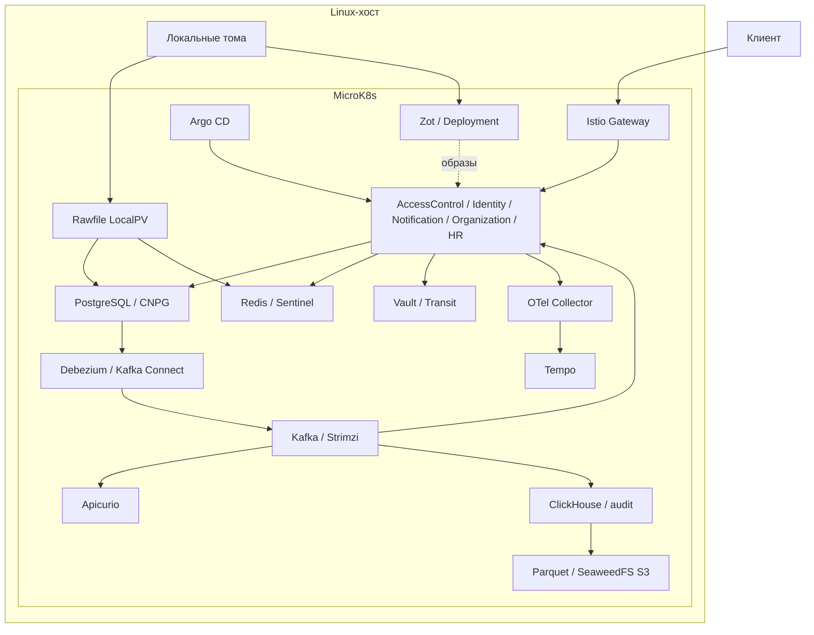

# @monadiam/stand-infrastructure

Language: [EN](README.md) | **RU**

DEV-стенд MonadIAM на одном узле MicroK8s: пять API-сервисов, PostgreSQL/Redis, Kafka/Debezium, Vault, GitOps и observability. Профиль в репозитории — `dev`.

Для запуска нужны Linux-хост, `just`, Go 1.27, Terraform 1.17.1, kubectl, Helm и Docker с доступом к daemon. Прикладные образы рассчитаны на `linux/amd64`. MicroK8s и локальные тома подготавливаются **до** `just start`. Нужен доступ к источникам образов, Helm charts, Go-модулей и Terraform providers либо настроенные зеркала.

----

<details>
<summary><strong>Что входит в стенд</strong></summary>

DEV работает на одном Linux-хосте. MicroK8s размещает платформу и приложения. Zot тоже работает в Kubernetes, но хранит образы на хостовом томе. У каждого из пяти сервисов отдельные PostgreSQL и Redis. На DEV по одному экземпляру каждой БД и один Kafka broker/controller.

> Автоматическое переключение на резервные экземпляры будет работать только при увеличении кол-ва реплик.



| Подсистема                                | Назначение                                                 |
| :---------------------------------------- | :--------------------------------------------------------- |
| Istio ambient и Gateway API               | Внешние HTTPS-маршруты, mTLS и политики доступа            |
| CNPG, Redis/Sentinel                      | Базы, права, сессии и очереди сервисов                     |
| Strimzi, Kafka Connect/Debezium, Apicurio | CDC, события и схемы                                       |
| Vault, cert-manager, VSO/ESO              | PKI, Transit и доставка секретов                           |
| ClickHouse, SeaweedFS                     | Загрузка audit/change events из Kafka и архив Parquet в S3 |
| Argo CD, Image Updater                    | Приложения и обновление образов через Git                  |
| Prometheus, Grafana, Loki, Tempo, OTel    | Метрики, логи и трейсы                                     |

</details>

----

<details>
<summary><strong>Подготовка и первый запуск</strong></summary>

Пространство `host` предназначено только для новой пустой Ubuntu 24.04 с snap и systemd. На уже подготовленном `linux` его не нужно запускать.

- `host::storage` создаёт и форматирует новые ext4-файлы.
- `host::install` создаёт отдельный ключ шифрования API на хосте.

Для другой ОС подготовка зависит от её способа установки MicroK8s и управления томами. `just start` эту подготовку не выполняет.

**Новая Ubuntu-машина.** Сначала проверьте интерфейс, доступное место и инструменты. Выберите размер томов, фактический IP и интерфейс. Текущий DEV-профиль использует имя узла `monadiam-dev`.

```sh
just host::inspect
just host::storage 320G 32G
just host::install 192.168.1.143
just host::calico wlo1
just host::limits
just host::verify
```

Команда `host::storage` не будет работать, если любой из двух файлов-томов уже существует. Его mount units находятся в `bootstrap/microk8s` и `bootstrap/zot`. Drop-in для MicroK8s требует смонтированный Rawfile и помещает службы в `monadiam.slice`. Команда `host::install` применяет launch config `clusters/dev/host/microk8s.yaml` с отдельным ключом из `/etc/monadiam/microk8s/encryption.key`. Ключ и итоговый launch config с ним не помещайте в Git. Команды установки и настройки Calico следуют документации [MicroK8s launch config](https://canonical.com/microk8s/docs/add-launch-config) и [host interfaces](https://canonical.com/microk8s/docs/configure-host-interfaces).

**Подготовить профиль и запустить.** Проверьте `KUBECONFIG`, `KUBE_CONTEXT`, `TF_STATE_DIR`, `VAULT_STATE_DIR`, `APPLICATIONS_IP` в `.env.dev`. Адреса в `clusters/dev/applications/endpoints/kustomization.yaml` и OAuth redirect URI в `clusters/dev/applications/identity/kustomization.yaml` должны соответствовать IP хоста.

```sh
just env::init
just env::check
just start
just status
just k8::diagnostics
```

Если Zot пуст, до полного запуска отдельно выполните `just k8::start` и `just zot::apply`, опубликуйте закреплённые в overlays образы через `just zot::push`, затем выполните `just start`. Порядок образов и GitOps описан [отдельно](docs/GITOPS.ru.md).

`just start` запускает MicroK8s, создаёт рабочий kubeconfig, применяет Zot, Terraform и платформу, затем ждёт пять Deployment и успешные ответы `/docs/` на портах 4001–4005. Argo CD читает удалённую ветку `dev`. Локальные незакоммиченные изменения приложений он не применяет.

</details>

----

<details>
<summary><strong>Команды</strong></summary>

В Just пространства имён записываются как `k8::start`. Также допустимо `just k8 start`. Запуск `just` без аргументов показывает список команд.

| Команда                                                       | Действие                                              |
| :------------------------------------------------------------ | :---------------------------------------------------- |
| `just start`, `just resume`                                   | Запустить стенд и проверить пять сервисов             |
| `just stop`, `just restart`                                   | Остановить или перезапустить стенд                    |
| `just status`, `just k8::diagnostics`                         | Состояние платформы, узлы, Pod, PVC и Events          |
| `just k8::start`, `just k8::stop`, `just k8::status`          | Управление MicroK8s                                   |
| `just zot::apply`, `just zot::status`, `just zot::logs`       | Реестр образов                                        |
| `just env::init`, `just env::check`                           | Файл окружения                                        |
| `just platform::reconcile <фаза>`                             | Одна фаза платформы                                   |
| `just platform::reconcile seaweedfs`                          | SeaweedFS buckets, ClickHouse schema и CronJob архива |
| `just tf::plan <root>`, `just tf::apply <root>`               | Terraform root                                        |
| `just vault::status`, `just vault::plan`, `just vault::apply` | Vault                                                 |
| `just gitops::ui`, `just gitops::credentials`                 | Argo CD                                               |
| `just cli::build`, `just cli::lint`, `just cli::format`       | Сборка, lint и форматирование Go CLI                  |
| `just tf::validate`, `just k8::validate`                      | Проверка Terraform и Kubernetes-конфигураций          |

> Команда `tf::apply` использует Terraform `-auto-approve`. Перед отдельным применением запускайте `tf::plan`.
> Опциональный Redis backup timer управляется через `host::redis-backup*` и не входит в запуск стенда.

</details>

----

## Навигация

- [Сеть, Istio, Gateway и доступ](docs/NETWORK.ru.md)
- [PostgreSQL, Redis, ClickHouse и SeaweedFS](docs/DATA.ru.md)
- [Kafka, Debezium и Apicurio](docs/MESSAGING.ru.md)
- [Vault, сертификаты и доставка секретов](docs/SECRETS.ru.md)
- [GitOps, образы и обновления](docs/GITOPS.ru.md)
- [Ресурсы, PVC и тома](docs/RESOURCES.ru.md)
