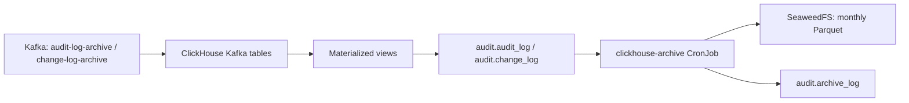

# Data and storage

Language: **EN** | [RU](DATA.ru.md)

Back to [README](../README.md)

PVC sizes and limits are listed in [resources](RESOURCES.md).

## PostgreSQL and Redis

| Component  | DEV topology                          | Connection                             |
| :--------- | :------------------------------------ | :------------------------------------- |
| PostgreSQL | Five CNPG Clusters, one instance each | Service DNS, TLS, and password         |
| Redis      | One Redis and Sentinel per service    | Sentinel discovery, mTLS, and password |

PostgreSQL stores each service's data and outbox. CNPG manages instances, roles, and certificates. DEV reads and writes through a single primary. WAL uses the `local-wal-retain` storage class.

Redis stores effective permissions, sessions, cache, and queues. All five instances use:

```text
appendonly yes
appendfsync everysec
no-appendfsync-on-rewrite no
maxmemory-policy noeviction
maxmemory 128mb
```

AOF syncs in the background, so a crash can lose the latest writes. `noeviction` prevents key eviction when memory is full. Sentinel has quorum 1 and no standby Redis replica to promote. Deleting Redis data affects more than cache.

Configuration: [PostgreSQL](../clusters/dev/infrastructure/postgresql) and [Redis](../clusters/dev/infrastructure/redis).

## ClickHouse and SeaweedFS

| Component            | Topology                     |
| :------------------- | :--------------------------- |
| ClickHouse           | One shard, one replica       |
| SeaweedFS master     | One replica                  |
| SeaweedFS volume     | One replica                  |
| SeaweedFS filer / S3 | One replica, S3 in the filer |

SeaweedFS uses placement `000` without replication. The bootstrap Job creates `audit-archive` and `change-log-archive` buckets and configures versioning, Object Lock, and lifecycle. DEV retains audit data for 1095 days and change log data for 365 days.



Strimzi grants `KafkaUser/kafka-main-archive` read access to two topics and consumer groups. ClickHouse reads them through Kafka tables and materialized views. Connection settings and the TLS CA are defined in ClickHouseInstallation. The `clusters` phase copies the KafkaUser password and CA into `monadiam-data`.

The `seaweedfs` phase runs bootstrap SQL for tables and views and installs `CronJob/clickhouse-archive`. The schema is in [SQL files](../clusters/dev/infrastructure/clickhouse/archive/chart/files), Job queries are in [files/queries](../clusters/dev/infrastructure/clickhouse/archive/chart/files/queries), and the schedule and endpoints are in [DEV values](../clusters/dev/infrastructure/clickhouse/archive-values.yaml). DEV runs at `0 2 * * *`. The CronJob has no `timeZone` field.

The archiver selects complete monthly partitions older than `ARCHIVE_AFTER_DAYS=120`. It creates one Parquet object per table and month, checks the S3 row count, and then records the object key in `audit.archive_log`. A repeat run without new rows creates no new version. If new `id` values arrive in an archived month, the Job combines the previous Parquet with new rows, validates the new object, and updates the log. The previous object remains in the bucket until its retention expires. ClickHouse TTL is 180 days from row ingestion (`ingested_at`), rather than event time (`created_at`).

Run or update it with `just start` or `just platform::reconcile seaweedfs` on a prepared stand. Inspect Pods and Events with `just k8::diagnostics`. The Job and CronJob are in `monadiam-data`. To check an archive, compare the latest `audit.archive_log` entry with its Parquet object. If the previous object is unavailable, the Job fails instead of recording an incomplete archive.

Sources: [ClickHouse DEV](../clusters/dev/infrastructure/clickhouse), [SeaweedFS DEV](../clusters/dev/infrastructure/seaweedfs), and [SeaweedFS bootstrap](../clusters/dev/infrastructure/seaweedfs/bootstrap-values.yaml).
