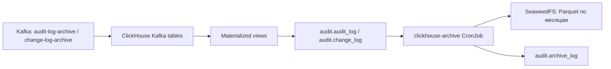

# Данные и хранилища

Language: [EN](DATA.md) | **RU**

Вернуться к [README](../README.ru.md)

Размеры PVC и лимиты приведены в [ресурсах](RESOURCES.ru.md).

## PostgreSQL и Redis

| Компонент  | Топология DEV                         | Подключение                       |
| :--------- | :------------------------------------ | :-------------------------------- |
| PostgreSQL | Пять CNPG Cluster, по одному instance | Service DNS, TLS и пароль         |
| Redis      | По одному Redis и Sentinel на сервис  | Sentinel discovery, mTLS и пароль |

PostgreSQL хранит данные и outbox своего сервиса. CNPG управляет экземплярами, ролями и сертификатами.
DEV читает и пишет в единственный primary. WAL вынесен в storage class `local-wal-retain`.

Redis хранит эффективные права, сессии, кеш и очереди. Для всех пяти экземпляров включены:

```text
appendonly yes
appendfsync everysec
no-appendfsync-on-rewrite no
maxmemory-policy noeviction
maxmemory 128mb
```

AOF синхронизируется в фоне. При аварии возможна потеря последних записей.
`noeviction` запрещает вытеснение ключей при заполнении памяти.
У Sentinel quorum 1, резервной Redis-реплики для переключения нет.
Удаление Redis-данных затрагивает не только кеш.

Конфигурации: [PostgreSQL](../clusters/dev/infrastructure/postgresql),
[Redis](../clusters/dev/infrastructure/redis).

## ClickHouse и SeaweedFS

| Компонент            | Топология                     |
| :------------------- | :---------------------------- |
| ClickHouse           | Один shard, одна replica      |
| SeaweedFS master     | Одна реплика                  |
| SeaweedFS volume     | Одна реплика                  |
| SeaweedFS filer / S3 | Одна реплика, S3 внутри filer |

SeaweedFS использует placement `000`, без репликации. Bootstrap Job создаёт buckets
`audit-archive` и `change-log-archive`, настраивает versioning, Object Lock и lifecycle.
Срок хранения в DEV: 1095 дней для audit и 365 дней для change log.



Strimzi выдаёт отдельному `KafkaUser/kafka-main-archive` права чтения двух topics и
consumer groups. ClickHouse читает их через Kafka tables и материализованные
представления. Настройки подключения и TLS CA задаются в ClickHouseInstallation.
Пароль KafkaUser и CA копируются в `monadiam-data` при фазе `clusters`.

Фаза `seaweedfs` запускает bootstrap SQL для таблиц и представлений и устанавливает
`CronJob/clickhouse-archive`. Схема лежит в [SQL файлах](../clusters/dev/infrastructure/clickhouse/archive/chart/files),
запросы Job — в [files/queries](../clusters/dev/infrastructure/clickhouse/archive/chart/files/queries),
расписание и адреса — в [DEV values](../clusters/dev/infrastructure/clickhouse/archive-values.yaml).
Расписание DEV: `0 2 * * *`. В CronJob не задано поле `timeZone`.

Архиватор выбирает целые месячные разделы старше порога `ARCHIVE_AFTER_DAYS=120`.
Он создаёт отдельный Parquet для каждой таблицы и месяца, проверяет число строк в S3
и только затем добавляет запись с ключом объекта в `audit.archive_log`.
Повторный запуск без новых строк не создаёт новую версию. Если в уже архивированный
месяц поступают события с новыми `id`, Job создаёт новый объект из прежнего Parquet
и новых строк, проверяет его и обновляет журнал. Прежний объект остаётся в bucket
до окончания его срока хранения. TTL ClickHouse составляет 180 дней **от поступления**
строки (`ingested_at`), а не от даты события (`created_at`).

Запуск и обновление: `just start` или `just platform::reconcile seaweedfs` на уже
подготовленном стенде. Pod и события видны через `just k8::diagnostics`.
Job и CronJob находятся в namespace `monadiam-data`.
Для проверки архива сопоставляйте последнюю запись `audit.archive_log` с указанным
Parquet объектом. Если объект больше недоступен, Job завершится ошибкой вместо
записи неполного архива.

Исходники: [ClickHouse DEV](../clusters/dev/infrastructure/clickhouse),
[SeaweedFS DEV](../clusters/dev/infrastructure/seaweedfs),
[SeaweedFS bootstrap](../clusters/dev/infrastructure/seaweedfs/bootstrap-values.yaml).
