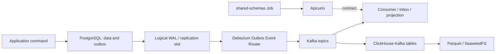

# Kafka, Debezium, and Schema Registry

Language: **EN** | [RU](MESSAGING.ru.md)

Back to [README](../README.md)

Run commands from `infrastructure/stand`.

| Component      | DEV configuration                                           |
| :------------- | :---------------------------------------------------------- |
| Kafka          | One KafkaNodePool with broker and controller in one Pod     |
| Replication    | RF=1 and minISR=1, including internal Connect topics        |
| Connect        | One distributed worker and five outbox connectors           |
| Debezium       | Strimzi builds the image and publishes it to Zot            |
| Partitions     | Four each for `realm`, `position`, and `projection-journal` |
| Snapshot       | `when_needed` through a DEV patch                           |
| JSON payload   | Preserve empty arrays through `optional_string`             |
| Apicurio       | One replica using KafkaSQL storage                          |
| Schemas        | Separate shared-schemas Job managed by Argo CD              |
| Archive topics | `audit-log-archive` and `change-log-archive`                |

A service writes its data change and outbox entry to PostgreSQL. Debezium reads logical WAL and publishes an event to Kafka. Consumers process the event independently of the original HTTP request.

Connector routing gets the partition count from KafkaTopic through Kustomize replacements. When changing the count, account for the routing key and ordering within each partition.

Base sets `snapshot.mode=no_data`. DEV overrides it with `when_needed`. If the WAL position is lost, Debezium may republish an existing outbox entry. After PostgreSQL recovery, check replication slots, available WAL, Connect offsets, and duplicate handling by consumers.

Apicurio stores its data in KafkaSQL topics. After Registry starts, the shared-schemas Job publishes the schema version compatible with the applications.

Strimzi grants `kafka-main-archive` `Read` and `Describe` permissions for two archive topics and two consumer groups. ClickHouse reads JSON payloads through Kafka tables and materialized views into `audit.audit_log` and `audit.change_log`. A CronJob then exports complete monthly partitions to SeaweedFS. [Data and storage](DATA.md) explains export and repeat archival.

Sources: [Kafka](../clusters/dev/infrastructure/kafka), [DEV overlay](../clusters/dev/infrastructure/kafka/kustomization.yaml), [archive KafkaUser](../clusters/dev/infrastructure/kafka/base/kafka-main-archive-user.yaml), [ClickHouse SQL](../clusters/dev/infrastructure/clickhouse/archive/chart/files), [Apicurio](../clusters/dev/infrastructure/apicurio), and [shared-schemas](../clusters/dev/applications/shared-schemas).
