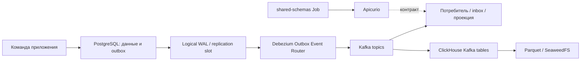

# Kafka, Debezium и Schema Registry

Language: [EN](MESSAGING.md) | **RU**

Вернуться к [README](../README.ru.md)

Команды выполняются из каталога `infrastructure/stand`.

| Компонент       | Настройка DEV                                            |
| :-------------- | :------------------------------------------------------- |
| Kafka           | Один KafkaNodePool, роли broker и controller в одном Pod |
| Репликация      | RF=1, minISR=1, включая внутренние topics Connect        |
| Connect         | Один distributed worker, пять outbox-коннекторов         |
| Debezium        | Образ собирает Strimzi и публикует в Zot                 |
| Partitions      | `realm`, `position`, `projection-journal` — по 4         |
| Snapshot        | `when_needed` через DEV patch                            |
| JSON payload    | Пустые массивы сохраняются через `optional_string`       |
| Apicurio        | Одна реплика, KafkaSQL storage                           |
| Schemas         | Отдельный shared-schemas Job под управлением Argo CD     |
| Архивные topics | `audit-log-archive`, `change-log-archive`                |

Сервис сохраняет изменение и outbox в PostgreSQL. Debezium читает logical WAL
и публикует событие в Kafka. Потребитель обрабатывает его независимо от завершения
исходного HTTP-запроса.

Число partitions в routing коннекторов берётся из KafkaTopic через Kustomize
replacements. При изменении числа partitions учитывайте ключ маршрутизации и порядок
событий внутри partition.

В base задан `snapshot.mode=no_data`, DEV перекрывает его значением `when_needed`.
При потере WAL-позиции Debezium может повторно опубликовать сохранённый outbox.
После восстановления PostgreSQL проверяйте replication slots, доступный WAL,
Connect offsets и обработку дубликатов потребителями.

Apicurio хранит данные в KafkaSQL topics. После старта Registry запускается
shared-schemas Job с версией схем, совместимой с приложениями.

Для архивных topics Strimzi создаёт отдельного пользователя `kafka-main-archive`
с правами `Read` и `Describe` на два topics и две consumer groups. ClickHouse
читает JSON payload через Kafka tables и материализованные представления в
`audit.audit_log` и `audit.change_log`. Затем CronJob выгружает завершённые
месячные разделы в SeaweedFS. Устройство выгрузки и повторной архивации
описано в [данных и хранилищах](DATA.ru.md).

Источники: [Kafka](../clusters/dev/infrastructure/kafka), [DEV overlay](../clusters/dev/infrastructure/kafka/kustomization.yaml), [архивный KafkaUser](../clusters/dev/infrastructure/kafka/base/kafka-main-archive-user.yaml), [ClickHouse SQL](../clusters/dev/infrastructure/clickhouse/archive/chart/files), [Apicurio](../clusters/dev/infrastructure/apicurio), [shared-schemas](../clusters/dev/applications/shared-schemas).
