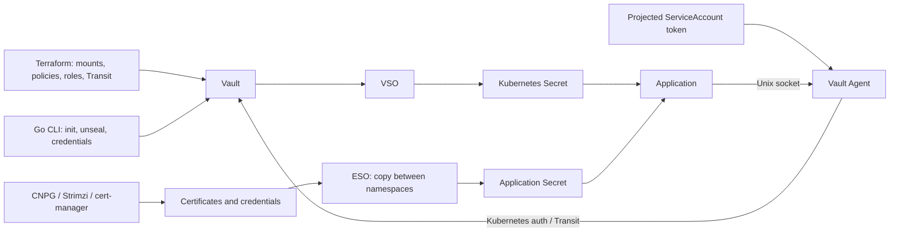

# Vault and secrets

Language: **EN** | [RU](SECRETS.ru.md)

Back to [README](../README.md)

Run commands from `infrastructure/stand`.

| Component                      | Responsibility                                                     |
| :----------------------------- | :----------------------------------------------------------------- |
| Terraform                      | KV v2, Transit, Kubernetes auth, policies, roles, and audit device |
| Go CLI                         | Initialization, unseal, and creation of missing credentials        |
| VSO                            | Sync Vault KV -> Kubernetes Secrets                                |
| ESO                            | Copy certificates and credentials between Kubernetes namespaces    |
| Vault Agent                    | Kubernetes auth and Unix socket for application requests to Vault  |
| Reloader / VSO restart targets | Restart Pods when related Secrets change                           |
| cert-manager                   | CA and TLS certificates                                            |

Vault runs Raft mode with one replica and a 2 GiB PVC. `VAULT_INIT_FILE` contains the root token and unseal keys. It must match the Vault data and remain outside the repository.

Vault readiness allows sealed and uninitialized states so bootstrap can initialize it. Check with `just vault::status` for `initialized=true` and `sealed=false`.

Applications receive SQL and Redis credentials from Kubernetes Secrets. The archive Job gets the ClickHouse `archive` user through `VaultStaticSecret/clickhouse-main-archive` and SeaweedFS keys through `VaultStaticSecret/seaweedfs-main-archiver`. Strimzi creates the `KafkaUser/kafka-main-archive` password. The `clusters` phase copies it and the Kafka CA into `monadiam-data` for ClickHouse. Credential values are not stored in Git.

Vault Agent runs as a permanent native sidecar using `initContainers` with `restartPolicy: Always`. It uses a projected ServiceAccount token and exposes `/vault/proxy/agent.sock` for application Transit requests.

The [secret contract](../contracts/secrets.yaml) lists KV paths, Secret names, and consumers. Its statuses describe the contract. Check current sync through VSO/ESO conditions.

Vault audit writes to stdout. Kubelet controls log rotation. Automatic delivery of audit logs to Loki is not configured.
