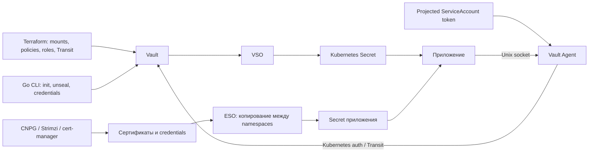

# Vault и секреты

Language: [EN](SECRETS.md) | **RU**

Вернуться к [README](../README.ru.md)

Команды выполняются из каталога `infrastructure/stand`.

| Компонент                      | Ответственность                                                 |
| :----------------------------- | :-------------------------------------------------------------- |
| Terraform                      | KV v2, Transit, Kubernetes auth, policies, roles и audit device |
| Go CLI                         | Инициализация, unseal, создание отсутствующих credentials       |
| VSO                            | Синхронизация Vault KV -> Kubernetes Secrets                    |
| ESO                            | Перенос сертификатов и credentials между Kubernetes namespaces  |
| Vault Agent                    | Kubernetes auth и Unix socket для запросов приложения к Vault   |
| Reloader / VSO restart targets | Перезапуск Pod при изменении связанных Secrets                  |
| cert-manager                   | CA и TLS-сертификаты                                            |

Vault работает в Raft mode с одной репликой и PVC 2 GiB.
`VAULT_INIT_FILE` содержит root token и unseal keys. Файл должен соответствовать
данным Vault и сохраняться отдельно от репозитория.

Vault readiness допускает sealed/uninitialized, чтобы bootstrap мог выполнить
инициализацию. Состояние проверяется через `just vault::status`:
`initialized=true`, `sealed=false`.

Приложения получают SQL/Redis credentials из Kubernetes Secrets.
Архивная Job получает пользователя ClickHouse `archive` через
`VaultStaticSecret/clickhouse-main-archive`, а ключи SeaweedFS — через
`VaultStaticSecret/seaweedfs-main-archiver`. Strimzi создаёт пароль
`KafkaUser/kafka-main-archive`. Фаза `clusters` копирует его и CA Kafka
в `monadiam-data` для ClickHouse. Значения credentials в Git не хранятся.

Vault Agent запускается как постоянный native sidecar: `initContainers`
с `restartPolicy: Always`. Он использует projected ServiceAccount token
и предоставляет `/vault/proxy/agent.sock` для Transit-запросов приложения.

[Контракт секретов](../contracts/secrets.yaml) содержит KV paths,
Secret names и потребителей. Статусы в этом файле описывают контракт.
Текущую синхронизацию проверяйте по conditions VSO/ESO.

Audit Vault направлен в stdout. Ротация этих файлов задаётся kubelet.
Автоматическая отправка audit logs в Loki не настроена.
